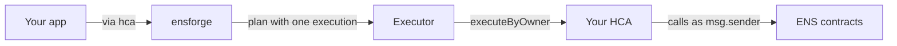

<Callout type="info" title="Experimental">
  `@ensforge/hca` is experimental for 1.0. Its API can change in a minor release.
</Callout>

A **hosted contract account (HCA)** is a smart contract wallet that ENS hosts for your wallet. Your wallet owns it, ENS's factory deploys it, and it calls ENS contracts on your behalf. Because it is a contract, it can run many calls as one atomic execution, and it can act without a wallet prompt when you approve a session.

## One account per owner

ensforge uses one HCA for each wallet on a chain. Its address derives from the owner and the deployment's initial implementation, so ensforge can compute it before it exists ([`hca.predictAddress`](/docs/reference/hca/hca/predict-address)). The address never changes, even after upgrades.

- The owner is fixed when the account is deployed. Nobody can change it.
- ensforge deploys the account on first use, through the ENS factory. You can also deploy it ahead of time with [`hca.deploy`](/docs/reference/hca/hca/deploy). Deploying twice returns the existing account.
- The account is not a place to keep names. It refuses name tokens, so a transfer of a name to an HCA fails with [`TRANSFER_DISALLOWED`](/docs/reference/errors/TRANSFER_DISALLOWED).

## How a write runs from the account

A normal write sends transactions from your wallet. A write with `via: hca()` sends a different [plan](/docs/reference/glossary#plan): ensforge wraps the calls in one `executeByOwner` call on your HCA, and the HCA calls the ENS contracts. `hca()` is a [route](/docs/reference/glossary#route).

The **executor** is the part that delivers the execution: your wallet (`owner()`, the default), an ERC-4337 bundler, Rhinestone or your own. ensforge uses the first executor in `executors`. With a session, it uses the first one that runs sessions. See [Your wallet](/docs/hca/your-wallet) and [Custom executors](/docs/hca/custom-executors).

ensforge adds two things around your calls:

- A setup step, sent by your wallet, that deploys the HCA when the executor cannot and approves the HCA to move the name tokens the write touches.
- Batches. Consecutive [steps](/docs/reference/glossary#step) without a wait run as one atomic execution, up to 32 calls. A step is never split. Every call succeeds or the whole execution reverts.

When a wrapped name is involved, the HCA becomes an operator of all your names in the [Name Wrapper](/docs/reference/glossary#name-wrapper). The plan warns with `HCA_WRAPPER_APPROVAL`. Revoke it with [`approval.setOperator`](/docs/reference/sdk/approval/set-operator) once the write is done.

## What the HCA can do

The HCA is `msg.sender` of the calls it runs, so it needs authority over what they touch. [Migration](/docs/reference/glossary#migration) and registration plan for it, and renewals work because anyone may renew. Other writes need the HCA to hold the [roles](/docs/reference/glossary#role) they use, and fail at simulation otherwise. See [Who can change a name](/docs/sdk/who-can-change-a-name).

ensforge never routes a write through an HCA unless you pass `via`.

## How ensforge trusts an account

Before it uses a deployed HCA, ensforge checks it. [`hca.get`](/docs/reference/hca/hca/get) returns the failed checks in `problems`. [`hca.verify`](/docs/reference/hca/hca/verify) throws [`HCA_NOT_VERIFIED`](/docs/reference/errors/HCA_NOT_VERIFIED) instead.

| Problem                    | Meaning                                                                             |
| -------------------------- | ----------------------------------------------------------------------------------- |
| `address-mismatch`         | The address is not the one derived from the owner.                                  |
| `owner-unavailable`        | The owner cannot be read from the account.                                          |
| `owner-mismatch`           | The account's owner is not the expected owner.                                      |
| `unknown-account`          | The account does not report the id `ens-standalone-hca.1.1.0`.                      |
| `untrusted-implementation` | The implementation is neither the factory's first one nor in the DAO's upgrade set. |
| `not-certified`            | The factory did not certify this owner for this account.                            |

A predicted account, not yet deployed, passes: its first execution deploys it. A write through `via: hca()` fails with `HCA_NOT_VERIFIED` when the deployed account has any problem.

## Who governs it

The factory has an owner, and the DAO keeps a set of implementations that accounts may upgrade to. An upgrade keeps the address and the sessions. See [Upgrades and governance](/docs/hca/upgrades-and-governance).

## When it is not available

- Only chains with an HCA deployment work: mainnet and Sepolia. Layer 2 plans do not route through an HCA, because the HCA lives on Ethereum.
- Sessions run only through Rhinestone. Bundlers run owner operations only. See [Sessions](/docs/hca/sessions).
