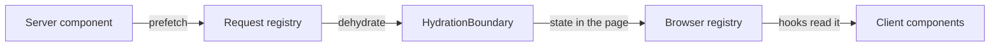

In the App Router, a server component prefetches the reads a page shows first. The browser then renders them immediately and revalidates them.

<Callout type="info" title="Server rendering helpers are unstable">
  `prefetch`, `dehydrate` and `HydrationBoundary` are marked `unstable`. Their names and shapes can
  change in a minor release.
</Callout>

## How it works

Reads that you did not prefetch render as loading on the server and run in the browser, so a server render never fans out RPC calls. Prefetched reads travel as plain JSON (bigints and bytes are tagged).



## 1. Share one client

Put the client in a module both the server component and the provider import.

**Example** (A Shared Client)

```ts title="lib/ens.ts"
import { createPublicClient, http } from "viem";
import { mainnet } from "viem/chains";

import { Ensforge } from "@ensforge/sdk";

export const ens = Ensforge.create({
  publicClient: createPublicClient({ chain: mainnet, transport: http() }),
});
```

## 2. Provide the client in a client component

`EnsforgeProvider` and the hooks are client components. A server component cannot pass the client object to them as a prop, so render the provider in a `"use client"` file that imports the client.

**Example** (The Providers File)

```tsx title="app/providers.tsx"
"use client";

import type { ReactNode } from "react";

import { EnsforgeProvider } from "@ensforge/react";

import { ens } from "../lib/ens";

export function Providers({ children }: { children: ReactNode }) {
  return <EnsforgeProvider client={ens}>{children}</EnsforgeProvider>;
}
```

```tsx title="app/layout.tsx"
import type { ReactNode } from "react";

import { Providers } from "./providers";

export default function RootLayout({ children }: { children: ReactNode }) {
  return (
    <html lang="en">
      <body>
        <Providers>{children}</Providers>
      </body>
    </html>
  );
}
```

## 3. Prefetch in the page

Create a new registry for each request, `prefetch` the reads, and pass `dehydrate(registry)` to `HydrationBoundary`. Prefetch with the same action and options the component reads with.

**Example** (A Name Page)

```tsx title="app/[name]/page.tsx"
import { AtomRegistry } from "effect/reactivity";

import { HydrationBoundary } from "@ensforge/react";
import { dehydrate, prefetch } from "@ensforge/react/server";
import { Actions } from "@ensforge/sdk";

import { ens } from "../../lib/ens";
import { Profile } from "./profile";

export default async function Page({ params }: { params: Promise<{ name: string }> }) {
  const { name } = await params;
  const registry = AtomRegistry.make();

  await prefetch(registry, ens, Actions.name.get, { name });

  return (
    <HydrationBoundary state={dehydrate(registry)}>
      <Profile name={name} />
    </HydrationBoundary>
  );
}
```

```tsx title="app/[name]/profile.tsx"
"use client";

import { useName } from "@ensforge/react";

export function Profile({ name }: { name: string }) {
  const { data } = useName({ name });

  return <p>{data?.owner}</p>;
}
```

- `prefetch` resolves once the read settles. A failed read is not sent, so the browser retries it.
- `useName` reads the same action and options, so it finds the prefetched value and does not fetch again.
- Without `staleTime`, a hydrated value revalidates once it is 30 seconds old.

## Stream slow reads

Do not await `prefetch` to stream. Call `dehydrate(registry, { streaming: true })`: reads that are still loading reach the browser as promises that resolve there, so the fast parts of the page appear first.

**Example** (Streaming A Subname List)

```tsx title="app/[name]/page.tsx"
import { Suspense } from "react";

import { AtomRegistry } from "effect/reactivity";

import { HydrationBoundary } from "@ensforge/react";
import { dehydrate, prefetch } from "@ensforge/react/server";
import { Actions } from "@ensforge/sdk";

import { ens } from "../../lib/ens";
import { Subnames } from "./subnames";

export default async function Page({ params }: { params: Promise<{ name: string }> }) {
  const { name } = await params;
  const registry = AtomRegistry.make();

  void prefetch(registry, ens, Actions.indexer.getSubnames, { name });

  return (
    <HydrationBoundary state={dehydrate(registry, { streaming: true })}>
      <Suspense fallback={<p>Loading subnames...</p>}>
        <Subnames name={name} />
      </Suspense>
    </HydrationBoundary>
  );
}
```

```tsx title="app/[name]/subnames.tsx"
"use client";

import { useSuspenseRead } from "@ensforge/react";
import { Actions } from "@ensforge/sdk";

export function Subnames({ name }: { name: string }) {
  const { data } = useSuspenseRead(Actions.indexer.getSubnames, { name });

  return (
    <ul>
      {data.items.map((item) => (
        <li key={item.name}>{item.name}</li>
      ))}
    </ul>
  );
}
```

Read a streamed value with [`useSuspenseRead`](/docs/react/suspense) inside `<Suspense>`: the fallback shows until the promise resolves. Paged hooks such as `useSubnames` fetch in the browser and do not read a prefetched value.

## Troubleshooting

### The browser fetches again after prefetching

The read in the component differs from the prefetched one. The action and the options must match. Names are compared normalised, so `Nick.eth` and `nick.eth` match.

### Next.js says a function cannot be passed to a client component

You passed the client from a server component. Import it in the `"use client"` providers file instead.

See [Caching and refreshing](/docs/react/caching-and-refreshing) for how hydrated reads revalidate, and the [reference for `prefetch`](/docs/react/reference/server) for every option.
