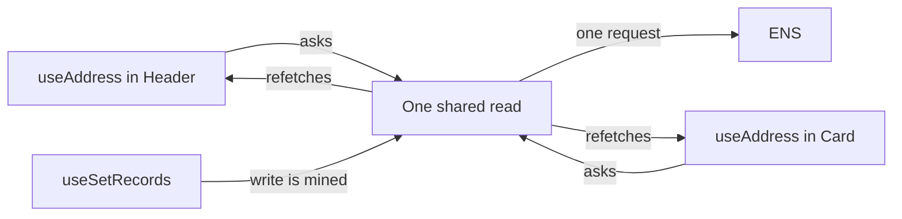

Hooks never fetch on their own schedule per component. They share one cached read per question, keep it for a while after the last component leaves, and refetch it when a write changes what it answers.

## How hooks share a read

A read is identified by the client's chain, account and indexer, the action and its options. Names are normalised (`Nick.eth` and `nick.eth` share one read) and addresses are compared in lowercase. Two components with the same identity share one request and one result, whatever their freshness settings.



After a write is mined, the read refetches and every component that uses it updates.

## Choose how fresh a read is

Four settings control freshness. Set them on a hook, or on the provider's `defaults` for every hook. A hook's own value wins.

| Setting                | Default      | Effect                                                                                                                                              |
| ---------------------- | ------------ | --------------------------------------------------------------------------------------------------------------------------------------------------- |
| `staleTime`            | none         | After this long, the next mount or window focus refetches in the background while the cached value stays on screen. `Duration.infinity` never does. |
| `idleTTL`              | `"1 minute"` | How long an unused read stays cached after its last component unmounts. `"forever"` keeps it.                                                       |
| `refetchInterval`      | none         | Refetches on this interval while the read is in use. Browser only: servers never poll.                                                              |
| `refreshOnWindowFocus` | `false`      | Refetches when the window regains focus, respecting `staleTime` when set.                                                                           |

Hooks with different settings still share the read's value and requests. When hooks disagree on `idleTTL`, the longest applies.

**Example** (Refetching A Name's State In The Background)

```tsx twoslash title="Expiry.tsx"
import { useName } from "@ensforge/react";

export function Expiry({ name }: { name: string }) {
  const { data, isRefreshing } = useName(
    { name },
    { staleTime: "30 seconds", refreshOnWindowFocus: true, idleTTL: "5 minutes" },
  );

  return (
    <span>
      {String(data?.expiry)} {isRefreshing && "(updating)"}
    </span>
  );
}
```

`data` stays on screen while `isRefreshing` is `true`. This pattern is called stale-while-revalidate.

## What unmounting does

An unmounted read keeps its result, and any request still in flight, for `idleTTL`. A remount within that time reuses both. A failed read is always stale, so a remount retries it.

## Refresh after a write

Writes made through ensforge refresh the reads they touched. You do not call anything.

- A write touches the names and accounts in its options, the parents of those names (for subname lists) and the signer (for primary names, approvals and "my names" lists).
- **Chain reads** refetch once the write's last transaction is mined. They refetch even if waiting for the receipt fails, because the transaction may have landed.
- **Indexer reads**, such as [infinite lists](/docs/react/infinite-lists), refetch once the indexer reports the write's block. ensforge polls for up to a minute, and gives an indexer with no status a few seconds instead.
- A write that fails after one step was confirmed refreshes too.
- A signature (`primaryName.signClaim`) sends no transaction and refreshes nothing.
- A read also follows the names its value mentions, such as a primary name, so changing that name's address refreshes it.

The write's result never waits for these refreshes. See [Write data](/docs/react/write-data).

## Refresh by hand

Every read hook returns `refresh()`. Call it to refetch one read now.

**Example** (A Refresh Button)

```tsx twoslash title="Refresh.tsx"
import { useAddress } from "@ensforge/react";

export function Refresh({ name }: { name: string }) {
  const { data, isRefreshing, refresh } = useAddress({ name });

  return (
    <button disabled={isRefreshing} onClick={refresh}>
      {data ?? "none"}
    </button>
  );
}
```

## Refresh after a change ensforge did not make

When another app, or a transaction sent outside ensforge, changes a name, call `invalidate` from `@ensforge/react/atoms`. It refetches every cached read of the given names and addresses, chain and indexer reads alike. It is unstable.

**Example** (Invalidating After An External Transaction)

```tsx title="Invalidate.tsx"
import { RegistryContext } from "@effect/atom-react";
import { useContext } from "react";

import { useEnsforge } from "@ensforge/react";
import { invalidate } from "@ensforge/react/atoms";

export function Invalidate({ name }: { name: string }) {
  const ens = useEnsforge();
  const registry = useContext(RegistryContext);

  return (
    <button onClick={() => invalidate(registry, ens, { names: [name] })}>Refresh {name}</button>
  );
}
```

## Hydrated reads

A value that came from the server renders first, then revalidates. With no `staleTime` set, a hydrated value counts as stale after 30 seconds. See [Next.js App Router](/docs/react/nextjs-app-router) and the other framework guides.
