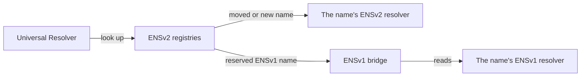

ENS runs on two sets of contracts at once. **ENSv1** is the original protocol. **ENSv2** is its
successor, which names move to over time. ensforge reads and writes both, and picks
the right one for each name, so most code never needs this page. Read it when you build tools that
show where a name lives, move names to ENSv2, or use features only one version has.

## ENSv1 and ENSv2

|                          | ENSv1                                                                    | ENSv2                                                                                          |
| ------------------------ | ------------------------------------------------------------------------ | ---------------------------------------------------------------------------------------------- |
| Where names are kept     | One registry for every name                                              | A tree of registries: each name can have its own registry for its subnames (a **subregistry**) |
| How a name is held       | Registry owner, plus a `.eth` registration token or a Name Wrapper token | One ERC-1155 token in the parent's registry                                                    |
| Who else may act         | Operators, token approvals, resolver delegates; Name Wrapper fuses       | **Roles**, granted per name or per registry                                                    |
| Default resolver         | Shared public resolver                                                   | A **PermissionedResolver** per name, with roles per record                                     |
| New `.eth` registrations | Not offered by ensforge: new names register on ENSv2                     | Paid in an ERC-20 token (USDC by default), as are renewals on both versions                    |

Both share what matters to most apps: names, [records](/docs/reference/glossary#record),
[resolvers](/docs/reference/glossary#resolver) and primary names work the same way. See [Names and records](/docs/sdk/names-and-records).

## The bridge

ENSv2 did not copy every ENSv1 name. Instead, ENSv2 lookups start in the ENSv2 registries and fall
through to ENSv1 for names that have not moved. ENSv1 `.eth` names are reserved in ENSv2, and each
reservation points at a read-only resolver that answers from ENSv1: the **ENSv1 bridge**.



The bridge is why a lookup works for every name with one call. It also means ENSv2 decides which
ENSv1 names it still reaches. An ENSv1 name whose parent moved to ENSv2 without it is no longer
reached: its ENSv1 records stop resolving, and so do its subnames'. `name.get` reports this as
`reachable: false`.

A second bridge works the other way: a read-only resolver on the ENSv1 side reads migrated names
from ENSv2. `resolver.get` reports the two bridges as `"ens-v1-resolver"` and `"ens-v2-resolver"`.
Nothing can be written to either.

## Kinds of name

`name.get` reports where each name lives as `kind`, and which protocol controls it as `protocol`.

| `kind`           | `protocol`       | Meaning                                                                                         |
| ---------------- | ---------------- | ----------------------------------------------------------------------------------------------- |
| `"v1-unwrapped"` | `"v1"`           | On ENSv1, held directly.                                                                        |
| `"v1-wrapped"`   | `"v1"`           | On ENSv1, held through the Name Wrapper. See [What wrapped names are](/docs/sdk/wrapped-names). |
| `"v2-native"`    | `"v2"`           | Registered on ENSv2.                                                                            |
| `"v2-migrated"`  | `"v2"`           | Moved from ENSv1 to ENSv2. Its ENSv1 entry is retired to a contract called the Graveyard.       |
| `"v2-reserved"`  | `"v2"`           | Reserved on ENSv2, with no ENSv1 owner.                                                         |
| `"available"`    | `"v2"` or `"v1"` | Not registered. May still resolve through a parent's resolver: check `inheritedResolver`.       |

**Example** (Reading Where Names Live)

```ts title="kinds.ts"
import { Ensforge, ensActions } from "@ensforge/sdk";
import { mainnet } from "viem/chains";

const ens = Ensforge.create({
  chain: mainnet,
}).extend(ensActions());

for (const name of ["nick.eth", "vitalik.eth"]) {
  const { kind, protocol, migrated } = await ens.name.get({ name });
  console.log(name, kind, protocol, migrated);
}
```

```text title="Output (mainnet, November 2026)"
nick.eth v2-migrated v2 true
vitalik.eth v1-unwrapped v1 false
```

Both names resolve with the same `record.getAddress` call. The kind matters only for the tasks
below.

## What ensforge unifies

These work the same for every kind of name. ensforge picks the contracts:

- Every read: records, addresses, avatars, primary names, `name.get`, `permission.get`.
- Writing records (`record.set`), changing the resolver (`resolver.set`), transferring
  (`name.transfer`), creating subnames (`subname.create`).
- Renewing `.eth` names (`registration.renew`), on either version.
- Setting primary names (`primaryName.set`).
- Batching, plans, errors and resuming.

`permission.get` maps ENSv1 ownership, approvals and fuses and ENSv2 roles to the same answers, so
a UI can show the same buttons for any name.

## Where the version shows through

Some features exist in one version only. Their actions say so in their reference page. Where the
protocol would refuse the call, they fail with a typed error before anything is sent.

| Only on ENSv1                                                             | Only on ENSv2                                                              |
| ------------------------------------------------------------------------- | -------------------------------------------------------------------------- |
| `name.setManager`, `name.setTtl`, `name.reclaim` (manager and registrant) | `role.*` (roles)                                                           |
| `approval.setToken`, `approval.getToken` (token approvals)                | `registry.*` (subregistries)                                               |
| `wrapper.*` (the Name Wrapper and fuses)                                  | `resolver.create`, `resolver.link`, `resolver.getLink`, `resolver.upgrade` |
| `dns.claim` (importing a DNS name)                                        | `name.getLabel` (recovering a label from its hash)                         |

- Name, approval, role, registry and Name Wrapper actions called on the other version fail with
  [`UNSUPPORTED_PROTOCOL`](/docs/reference/errors/UNSUPPORTED_PROTOCOL).
- A task that needs the name on ENSv2 first fails with
  [`NAME_REQUIRES_MIGRATION`](/docs/reference/errors/NAME_REQUIRES_MIGRATION).
- A feature the chain's deployment lacks fails with
  [`UNSUPPORTED_ON_DEPLOYMENT`](/docs/reference/errors/UNSUPPORTED_ON_DEPLOYMENT).

See [Upgrading names](/docs/sdk/move-a-name-to-ensv2) for the ENSv2-only features and
[Wrapped names](/docs/sdk/wrapped-names) for the ENSv1 ones.

## Moving a name to ENSv2

An ENSv1 name moves to ENSv2 by [migration](/docs/reference/glossary#migration). `migration.get` says whether a name can move, how,
and what it would become. `migration.migrate` moves one or more names with their records and
subnames. A [locked](/docs/reference/glossary#locked) subname can move only after its
parent; `migrateParents` moves those parents first. See [Move a name to ENSv2](/docs/sdk/move-a-name-to-ensv2).

## Deployments

ensforge ships the ENS contracts for Ethereum mainnet and Sepolia, both with ENSv1 and ENSv2. The
client picks them from the chain of its viem client and exposes them as `ens.deployment`. Devnets
and forks pass their own with `deployment`. See
[Addresses and chains](/docs/contracts/addresses-and-chains).
