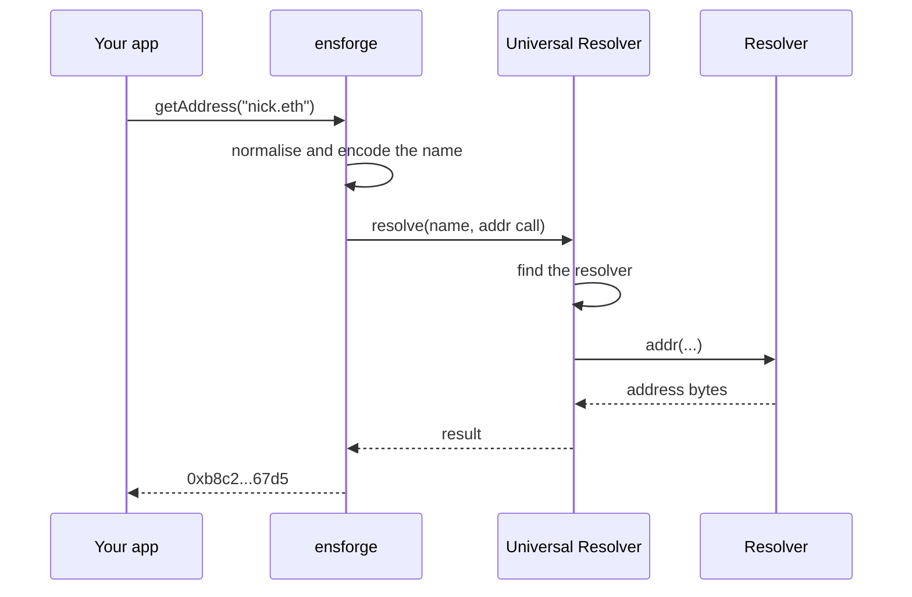
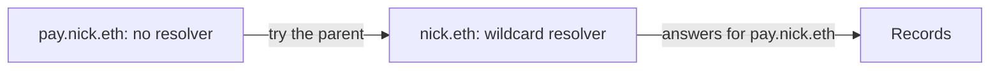
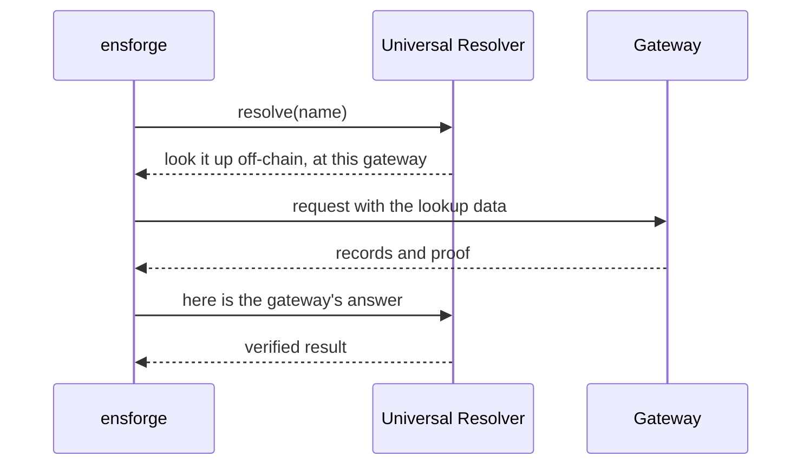

A **lookup** (resolution) turns a name into one of its records. It has two parts: find the
[resolver](/docs/reference/glossary#resolver) that serves the name, then ask that resolver for
the record. ensforge does both in a
single call to the **Universal Resolver**, a contract ENS deploys for exactly this.

## The path of one lookup

When you call `ens.record.getAddress({ name: "nick.eth" })`, the request travels like this:



- ensforge [normalises](/docs/reference/glossary#normalisation) the name first. An invalid name
  fails with [`INVALID_NAME`](/docs/reference/errors/INVALID_NAME) before any request is made.
- The Universal Resolver finds the right resolver wherever the name lives, so ensforge never has to
  ask you where a name is registered.
- ensforge decodes the answer: an address for the right chain, a text string, a website link.

## When a name has no resolver of its own

Not every name has its own resolver. A parent name can serve all of its
[subnames](/docs/reference/glossary#subname) from one
**wildcard resolver** (ENSIP-10), without creating each subname on-chain. To find the resolver, the
Universal Resolver walks up the name: `pay.nick.eth`, then `nick.eth`, then `eth`, and uses the
first resolver it finds. A resolver found on a parent answers only if it supports wildcard lookups.



Basenames resolve this way: `jesse.base.eth` has no resolver of its own and is served by the
resolver of `base.eth`. `name.get` reports such a resolver as `inheritedResolver`, because the
name has none of its own.

**Example** (Seeing an Inherited Resolver)

```ts title="inherited.ts"
import { Ensforge, ensActions } from "@ensforge/sdk";
import { createPublicClient, http } from "viem";
import { mainnet } from "viem/chains";

const ens = Ensforge.create({
  publicClient: createPublicClient({ chain: mainnet, transport: http() }),
}).extend(ensActions());

const state = await ens.name.get({ name: "jesse.base.eth" });
console.log(state.resolver, state.inheritedResolver, state.available);

console.log(await ens.record.getAddress({ name: "jesse.base.eth" }));
```

```text title="Output"
null 0xde9049636F4a1dfE0a64d1bFe3155C0A14C54F31 true
0x2211d1D0020DAEA8039E46Cf1367962070d77DA9
```

`available` is `true` because the name is in no registry on Ethereum, yet it resolves. Check
`inheritedResolver` before you tell a user that such a name is free. Writes go to the name's own
resolver only, never to an inherited one.

## When records live off-chain

Some resolvers do not store records on Ethereum at all. They answer with a pointer to a
**gateway**: a server that holds the records, often with a proof that they are correct. This
protocol is called **CCIP-Read** (EIP-3668), and names served this way are **off-chain names**.
`jesse.base.eth` is one.



ensforge follows these steps for you, so an off-chain name reads exactly like an on-chain one. The
Universal Resolver sends off-chain lookups through a **batch gateway**, which collects them and
forwards each one to the resolver's own gateway. By default ensforge uses the Universal Resolver's own
batch gateway. `ccipRead: { gatewayUrls }` on the client, or `gatewayUrls` on one call, replaces it
with batch gateways you choose. `ccipRead: false` turns off-chain lookups off, after which they
fail with [`CCIP_READ_DISABLED`](/docs/reference/errors/CCIP_READ_DISABLED). A gateway that fails or
answers badly raises a `GatewayError`. See [Look up off-chain names](/docs/sdk/off-chain-names).

DNS names such as `example.com` can resolve in a similar way: a DNSSEC proof shows that the DNS
owner set the name's ENS data. A proof that does not verify raises a `DnsError`. See
[Known limitations](/docs/reference/known-limitations#dns-names).

## Missing data is `null`, unless you ask for errors

A lookup that finds nothing is a normal answer. A missing record, a name without a resolver or an
address without a primary name returns `null`, so you handle it with an `if`, not a `try`.

Pass `strict: true` to get an error instead. The error says why nothing was found:
[`RESOLVER_NOT_FOUND`](/docs/reference/errors/RESOLVER_NOT_FOUND) when the name has no resolver,
[`RECORD_NOT_FOUND`](/docs/reference/errors/RECORD_NOT_FOUND) when the record is not set. Network,
gateway and input errors are thrown either way.

## Many lookups, few requests

ensforge keeps the number of requests low without any work on your side:

- `record.get` reads any mix of records for one name in one Universal Resolver call.
- Reads made at the same time are grouped into multicall requests (`batch.multicall` on the
  client, on by default).
- `ens.batch` runs many reads, for many names, together. Lookups keep their Universal Resolver
  call inside the batch, so off-chain names still work.

See [Look up many at once](/docs/sdk/look-up-many-at-once).

## What ensforge does for you

- Normalises, validates and encodes the name.
- Finds the resolver through the Universal Resolver, including wildcard and inherited resolvers.
- Follows off-chain lookups through gateways, including DNS names proven with DNSSEC.
- Decodes every record type into plain values, and returns `null` for missing data.
- Reads at the block you choose, with `blockNumber` or `blockTag`.
- Batches concurrent reads.
