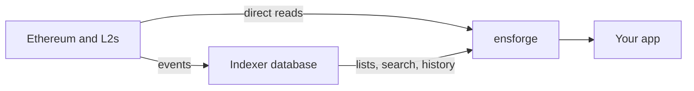

The chain answers questions about one name well: its owner, its resolver, its records. It cannot
answer questions about many names at once, such as "which names does this address own?" or "which
names start with `vit`?". Those come from an **indexer**: a service that reads every ENS event from
the chain and keeps a database you can query.

## What comes from where

| Question                                             | Answered by                                          | Actions                                      |
| ---------------------------------------------------- | ---------------------------------------------------- | -------------------------------------------- |
| What is this name's address, owner, expiry, records? | The chain                                            | `record.*`, `name.get`, `primaryName.get`, … |
| Which names does this address hold?                  | An indexer                                           | `indexer.getNamesForAddress`                 |
| What are the subnames of this name?                  | An indexer                                           | `indexer.getSubnames`                        |
| Which names match this text?                         | An indexer                                           | `indexer.search`                             |
| What happened to this name over time?                | An indexer (full history), the chain (a block range) | `indexer.getHistory`, `event.get`            |

The chain is the source of truth, and every read action asks it directly. An indexer is fast and
can list and search, but it is a copy that can be a few blocks behind. Use the chain for anything a
decision depends on, such as whether a name is available or who may change it.



## Connect an indexer

Indexer actions are a separate group, because they need an indexer service. Pass one as `indexer`
when you create the client, and add `indexerActions()`.

**Example** (Listing Subnames Through an Indexer)

```ts title="subnames.ts"
import { Ensforge } from "@ensforge/sdk";
import { bigname, fallback, goldsky, indexerActions } from "@ensforge/sdk/indexer";
import { createPublicClient, http } from "viem";
import { mainnet } from "viem/chains";

const ens = Ensforge.create({
  publicClient: createPublicClient({ chain: mainnet, transport: http() }),
  indexer: fallback([bigname(), goldsky()]),
}).extend(indexerActions());

const page = await ens.indexer.getSubnames({ name: "ens.eth", limit: 3 });

console.log(
  page.items.map((subname) => subname.name),
  page.hasMore,
  page.indexer,
);
```

```text title="Output"
[ 'app.ens.eth', 'attestations.ens.eth', 'coldwallet.ens.eth' ] true bigname
```

Two indexers are built in, and `fallback` combines them:

| Indexer                | Serves                        | Notes                                                                                           |
| ---------------------- | ----------------------------- | ----------------------------------------------------------------------------------------------- |
| `bigname()`            | ENS on mainnet and Sepolia    | The indexer the ENS app uses. Supports snapshots and finality, and verified (on-chain) answers. |
| `goldsky()`            | ENS on mainnet, and Basenames | Latest state only, with fewer fields.                                                           |
| `fallback([a, b])`     | Whatever its indexers serve   | Asks the next indexer when one is down, rate limited, behind, or does not serve the query.      |
| `defineIndexer({...})` | Your own source               | Adapts any API to the same actions. See [Custom indexers](/docs/sdk/custom-indexers).           |

Without an indexer, indexer actions fail with
[`INDEXER_NOT_CONFIGURED`](/docs/reference/errors/INDEXER_NOT_CONFIGURED). See
[Connect an indexer](/docs/sdk/connect-an-indexer).

## Pages and cursors

Lists come in pages. Each page has `items`, `hasMore`, and a `cursor` you pass back for the next
page. `paginate` from `@ensforge/sdk/indexer` walks every page with `for await`, and stops
requesting when you `break`. See [Load more results](/docs/sdk/load-more-results).

## Every answer says how complete it is

Indexers differ in what they serve, and can be behind the chain. So every answer carries metadata
next to its data:

- `indexer`: which indexer answered, such as `"bigname"`.
- `completeness`: `"full"`, `"partial"` or `"unsupported"`, with `unsupportedReason` and
  `unsupportedFields` when it is not full.
- `asOf`: the block the answer reflects, with its number and timestamp.
- `origin`: whether the answer came from the index or was `"verified"` by an on-chain read.

Check `completeness` before you show a list as complete, and `asOf` when freshness matters.
Indexers can disagree on some fields, so compare answers from one indexer only. See
[Known limitations](/docs/reference/known-limitations#indexers).

## What ensforge does for you

- Gives every indexer the same actions and result types, so you can switch or combine them.
- Falls back to the next indexer on failure, and sends follow-up pages to the indexer that issued
  the cursor.
- Retries rate-limited and timed-out requests, and reports failures as typed `IndexerError`s.
- Uses the indexer during migration to find a name's records and subnames for you.
