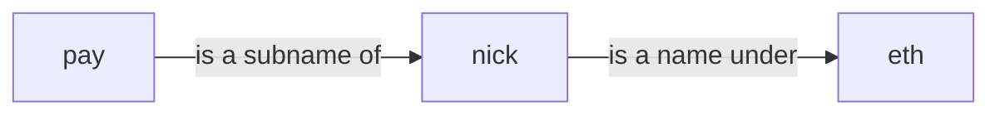
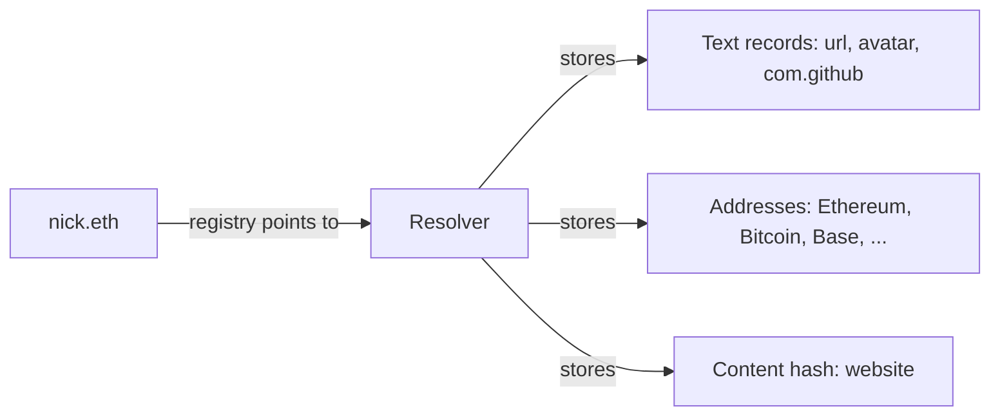

ENS, the Ethereum Name Service, maps human-readable names such as `nick.eth` to data: addresses on
any chain, a profile, a website. A name is held by an account, like a token. The data a name points
to lives in its **records**, which a contract called a **resolver** stores and answers for.

## What a name is made of

A **name** is a list of **labels** separated by dots. Read from the right, each label is a level.



- `eth` is the **top-level domain** (TLD). Most ENS names end in `.eth`, but DNS names such as
  `example.com` can be imported too.
- `nick.eth` is a **`.eth` name**: a second-level name bought from the `.eth` registrar for a
  period of time.
- `pay.nick.eth` is a **subname**. The holder of `nick.eth` creates it, and decides who holds it.

Names are case-insensitive and can contain emoji and most scripts. Before a name is used, it is
**normalised** (ENSIP-15): `Nick.ETH` becomes `nick.eth`, and names that could be confused with
others are rejected. Contracts identify a name by a hash of it called the **namehash**. ensforge normalises and hashes every name you pass, so you work with plain strings.
An invalid name fails with [`INVALID_NAME`](/docs/reference/errors/INVALID_NAME). See the
[glossary](/docs/reference/glossary#namehash) and the `Name` utilities in the
[utilities reference](/docs/reference/sdk/utilities).

## Who holds a name

ENS keeps track of every name in a **registry**: who holds it, which resolver serves it and, for
names that are bought, when it expires. The account that holds a name is its **owner**. The owner
can transfer the name, change its resolver, create subnames and edit its records, and can let other
accounts do some of these things.

A `.eth` name is registered for a period and then renewed. After its **expiry** it enters a
**grace period**, during which it can still be renewed but nobody else can register it; after that,
anyone can register it again.

`name.get` reads all of this in one call: owner, expiry, status and resolver. See
[Get a name's owner, expiry and status](/docs/sdk/get-name-details) and
[Who can change a name](/docs/sdk/who-can-change-a-name).

## Where records live

A name does not store its records itself. The registry points the name at a **resolver**, and the
resolver stores the records and answers questions about them.



Most names use a public resolver that ENS deploys, so any owner can store records there. Some
names use a resolver that fetches records from a server, so a name can resolve without anything on
Ethereum. Either way, reading looks the same. See [How a lookup works](/docs/sdk/looking-up-a-name).

## Kinds of record

| Record       | What it holds                                                                                                                 | Read it with                                                           |
| ------------ | ----------------------------------------------------------------------------------------------------------------------------- | ---------------------------------------------------------------------- |
| Address      | An address for one chain or coin, chosen by its **coin type** (ENSIP-9, ENSIP-11). Ethereum is the default.                   | [`record.getAddress`](/docs/reference/sdk/record/get-address)          |
| Text         | A string under a key: `url`, `avatar`, `description`, `com.twitter`, `com.github`, or any key you choose (ENSIP-5).           | [`record.getText`](/docs/reference/sdk/record/get-text)                |
| Avatar       | A text record with an image link: HTTPS, IPFS, Arweave or an NFT (ENSIP-12). ensforge turns it into a URL a browser can load. | [`record.getAvatar`](/docs/reference/sdk/record/get-avatar)            |
| Content hash | A website or file on IPFS, IPNS, Swarm, Arweave and similar (ENSIP-7).                                                        | [`record.getContentHash`](/docs/reference/sdk/record/get-content-hash) |
| ABI          | A contract ABI (ENSIP-4).                                                                                                     | [`record.get`](/docs/reference/sdk/record/get)                         |
| Public key   | A SECP256k1 public key.                                                                                                       | [`record.get`](/docs/reference/sdk/record/get)                         |
| Name         | The name an address is known by, used for primary names (ENSIP-3).                                                            | [`record.get`](/docs/reference/sdk/record/get)                         |
| Interface    | The contract implementing an ERC-165 interface for the name.                                                                  | [`record.get`](/docs/reference/sdk/record/get)                         |
| Data         | Raw bytes under a key (ENSIP-24).                                                                                             | [`record.get`](/docs/reference/sdk/record/get)                         |

`record.get` reads any mix of these in one request. Its result has exactly the fields you asked
for, and a record that is not set is `null`.

**Example** (Reading Several Records at Once)

```ts title="records.ts"
import { Ensforge, ensActions } from "@ensforge/sdk";
import { mainnet } from "viem/chains";

const ens = Ensforge.create({
  chain: mainnet,
}).extend(ensActions());

const profile = await ens.record.get({
  name: "nick.eth",
  texts: ["url", "com.github"],
  addresses: ["eth", "btc"],
});

console.log(profile);
```

```text title="Output"
{
  resolver: '0xF4f1007EA430848F2fAd60e405A54Fc100fEc341',
  texts: { url: 'https://ens.domains/', 'com.github': 'arachnid' },
  addresses: { eth: '0xb8c2C29ee19D8307cb7255e1Cd9CbDE883A267d5', btc: null }
}
```

`btc` is `null` because `nick.eth` has no Bitcoin address. `resolver` is the contract that
answered. See [Get text records](/docs/sdk/get-text-records).

## From an address back to a name

Records go from a name to data. A **primary name** goes the other way: from an address to the one
name its owner chose to be known by (ENSIP-19). Wallets and apps show it instead of a `0x` address.

Anyone can claim any name in their own reverse record, so a primary name only counts when the name
also points back to the same address. `primaryName.get` checks this for you, and returns `null`
when the check fails. An address can have a different primary name on each chain. See
[Get the name for an address](/docs/sdk/get-a-primary-name).

## What ensforge does for you

- Normalises and hashes every name, and rejects invalid ones with a typed error.
- Finds the resolver of any name and reads every record you ask for in one request.
- Encodes and decodes addresses for each coin, content hashes and ABIs, so you pass and receive
  plain strings and objects.
- Turns avatars into loadable URLs, including NFT avatars and IPFS links.
- Verifies primary names before returning them.
