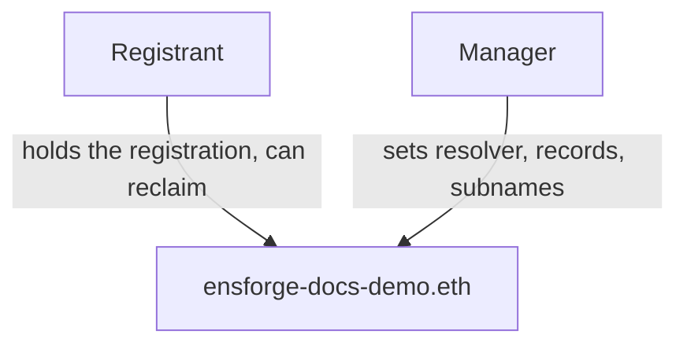
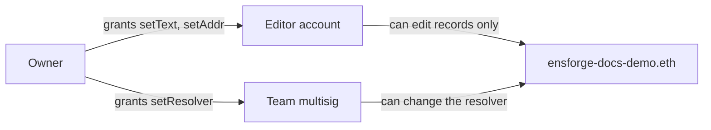

Every change to a name, from editing a record to creating a subname, is checked by a contract
against the account that sends it. The **owner** can do almost everything. Other accounts can be
allowed to do some things ([permissions](/docs/reference/glossary#permission)). ensforge reads all of these rules and answers one question for you: what
may this account do with this name?

## The owner

The **owner** is the account that holds the name. It can transfer the name, point it at a
resolver, create and remove subnames, and edit its records. Renewing a `.eth` name is open to
anyone, because paying for more time never hurts the owner.

`name.get` returns the owner. See [Get a name's owner, expiry and status](/docs/sdk/get-name-details).

## Accounts the owner allows

An owner can let other accounts act without giving the name away. ENS has a few ways to do this,
each with a different reach:

| Allowed account      | Can do                                                                                                              | Set with                                                            |
| -------------------- | ------------------------------------------------------------------------------------------------------------------- | ------------------------------------------------------------------- |
| **Operator**         | Everything the owner can do, for every name the owner holds on that contract.                                       | [`approval.setOperator`](/docs/reference/sdk/approval/set-operator) |
| **Approved address** | Transfer one name token.                                                                                            | [`approval.setToken`](/docs/reference/sdk/approval/set-token)       |
| **Delegate**         | Edit the records of one name on a public [resolver](/docs/reference/glossary#resolver).                             | [`approval.setDelegate`](/docs/reference/sdk/approval/set-delegate) |
| **Role holder**      | Exactly the actions its roles name, such as `setResolver` or `setText`, on one name or on every name of a contract. | [`role.grant`](/docs/reference/sdk/role/grant)                      |

To let someone edit a name's records, whatever kind of resolver it has, use
[`permission.setRecordAccess`](/docs/reference/sdk/permission/set-record-access): it picks
the right mechanism.

## Owner, manager and registrant

Names still on [ENSv1](/docs/reference/glossary#ensv1), the original ENS contracts, can split
control in two. The **registrant** holds the
`.eth` registration, and the **manager** controls the name in the registry: its resolver, records
and subnames. The registrant can always take management back.



Most names have the same account in both places, and `name.transfer` moves both by default. When
they differ, `name.get` reports both, and `owner` is the account with final control. Names wrapped
in the [Name Wrapper](/docs/reference/glossary#name-wrapper) add **fuses**, permanent switches
that remove permissions. See
[What wrapped names are](/docs/sdk/wrapped-names).

## Roles

Names on [ENSv2](/docs/reference/glossary#ensv2) replace the split above with **roles**: named permissions that an owner grants to
other accounts, one by one. A role can apply to one name, or to every name of a registry or
resolver. Each role has an admin role that may grant and revoke it.



Roles let a team share a name without sharing a key. See
[Roles and permissions](/docs/sdk/roles-and-permissions).

## One question, one answer

The rules above differ by name, but you never have to work them out. `permission.get` reads every
source of permission that applies to a name and returns the same shape for any name.

**Example** (Reading What an Account May Do)

```ts title="permissions.ts"
import { Ensforge, ensActions } from "@ensforge/sdk";
import { mainnet } from "viem/chains";

const ens = Ensforge.create({
  chain: mainnet,
}).extend(ensActions());

const { can } = await ens.permission.get({
  name: "nick.eth",
  account: "0xb8c2C29ee19D8307cb7255e1Cd9CbDE883A267d5",
});

console.log(can);
```

```text title="Output"
{
  transfer: true,
  setResolver: true,
  setSubregistry: true,
  createSubname: true,
  removeSubname: true,
  renew: true,
  setTtl: false,
  setManager: false,
  reclaim: false,
  setRecords: true
}
```

- Each answer is `true`, `false`, or `null` when the rules are unknown, as with a custom resolver.
- `setTtl`, `setManager` and `reclaim` are `false` here because they only exist for names with a
  manager, and `nick.eth` has moved to ENSv2, which has none.
- Use it to show or hide buttons before the user tries anything.

`permission.check` answers for one operation and lists exactly what is missing, such as the roles
to request. See [`permission.check`](/docs/reference/sdk/permission/check).

## Names on L2s

An L2 name is controlled by its namespace's contracts on the L2. The holder of its token may change it, and so may an approved address or an operator. On Basenames and Linea Names, resolver delegates may write records too, and burned NameWrapper fuses limit a Linea name. `permission.check` and `permission.get` answer from the L2. See [Work with names on L2s](/docs/sdk/names-on-l2s).

## What ensforge does for you

- Reads ownership, approvals, roles and fuses for any name, and combines them into one answer.
- Checks permission before planning a write, so a write the account may not make fails with
  [`NOT_OWNER`](/docs/reference/errors/NOT_OWNER) or [`MISSING_ROLES`](/docs/reference/errors/MISSING_ROLES)
  before the wallet prompt, naming what is missing.
- Picks the right contract and mechanism when you grant access or transfer a name.
