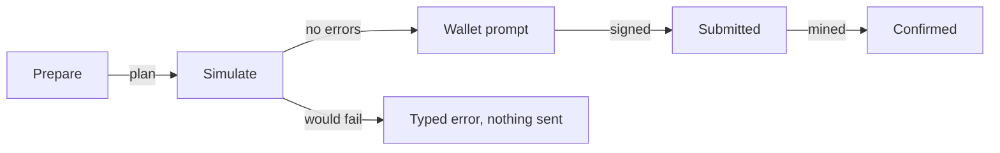
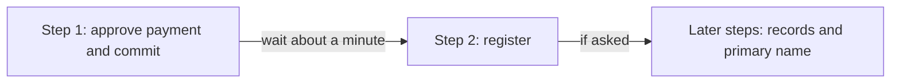

A **write** changes ENS: it sets [records](/docs/sdk/reference/glossary#record), registers or transfers a name, creates a subname. Writes
are transactions signed by a wallet. Many ENS tasks need more than one transaction, sometimes with
a wait in between, so ensforge first turns every write into a **plan**: a list of steps, each with
the contract calls it makes. Then it checks the plan, sends it, and saves its progress.

## The life of a write

Every write goes through the same stages. You can stop after any of the first three to show the
user what will happen.



1. **Prepare.** ensforge reads the current state of the name, checks that the account is allowed
   to make the change, and builds the plan. Wrong input or a missing permission fails here, with a
   typed error such as [`NOT_OWNER`](/docs/sdk/errors/NOT_OWNER).
2. **Simulate.** Every call is run against the current chain state without sending it, so a call
   that would revert becomes a typed error before the wallet asks the user to sign.
3. **Send.** The wallet signs and submits each step in order.
4. **Confirm.** The `…Sync` form waits for the receipts.

ensforge never sends a transaction during prepare or simulate. Simulation is on by default; set
`simulate: false` on the client or on one write to skip it.

## Methods for each stage

Each write action carries methods for each stage.

| Call                                  | Returns                                                   | Sends? |
| ------------------------------------- | --------------------------------------------------------- | ------ |
| `ens.record.set.prepare(options)`     | `Plan`                                                    | No     |
| `ens.record.set.simulate(options)`    | `Plan.Simulation`: `ok`, and each step's error            | No     |
| `ens.record.set.estimateGas(options)` | `Plan.Estimate`: total `gas` and ETH `value`              | No     |
| `ens.record.set(options)`             | `{ hash, hashes, id, plan }` once every step is submitted | Yes    |
| `ens.record.setSync(options)`         | The same, plus `receipt` and `receipts` once mined        | Yes    |

**Example** (Reviewing a Plan Before Sending)

```ts title="review.ts"
import { Ensforge, ensActions } from "@ensforge/sdk";
import { createPublicClient, createWalletClient, custom, http, type EIP1193Provider } from "viem";
import { sepolia } from "viem/chains";

declare const provider: EIP1193Provider;

const ens = Ensforge.create({
  publicClient: createPublicClient({ chain: sepolia, transport: http() }),
  walletClient: createWalletClient({ chain: sepolia, transport: custom(provider) }),
}).extend(ensActions());

const options = { name: "alice.eth", texts: { url: "https://alice.dev" } };

const plan = await ens.record.set.prepare(options);
const { gas } = await ens.record.set.estimateGas(options);

console.log(
  plan.steps.map((step) => step.description),
  plan.warnings,
  gas,
);
```

- `plan.steps` lists what will happen, in words a UI can show (`"Set records"`).
- `plan.warnings` holds notes that do not block the write, and `plan.requirements` what the account
  needs first, such as a token balance.
- A plan is plain data: you can save it, or send its `calls` with any tool.

See [Preview before sending](/docs/sdk/preview-before-sending).

## Steps, waits and bundles

Most writes are one [step](/docs/sdk/reference/glossary#step) with one call. Some are longer.
Registering a `.eth` name commits first, waits at least a minute of chain time, then registers.
When you ask for them, later steps write records to a resolver you chose and set the primary
name. The plan holds each wait, so ensforge sends
the next step only when the chain allows it.



How the steps reach the wallet depends on the wallet, set with `mode`:

- `"auto"` (default) sends consecutive steps as one [bundle](/docs/sdk/reference/glossary#bundle)
  when the wallet supports atomic batches (EIP-5792), and one transaction per call otherwise.
- `"batch"` always uses one EIP-5792 call per bundle. `"sequential"` sends one transaction at a
  time, each after the previous one is mined.
- A bundle holds at most `maxBundleCalls` calls (default 10) and never spans a wait.

`onStep` reports each step as it is `waiting`, `submitted`, `confirmed` or `failed`, for progress
UIs. See [Send a transaction](/docs/sdk/send-a-transaction) and
[Bundle transactions](/docs/sdk/bundle-transactions).

## When something fails halfway

A user can reject the second signature, close the tab during a wait, or lose their connection. The
plan's progress is saved in the client's `storage` as each step is submitted, so the write does not
start over.

- The error of a failed write carries `context.planId`.
- `ens.plan.resume({ id })` continues from the first step not yet submitted. Steps already sent are
  confirmed, not sent again, and each remaining step is simulated again right before it is sent.
- The default storage is in memory. Pass `storage: Plan.localStorage()` when creating the client to
  survive a page reload.

See [Continue after a failure](/docs/sdk/continue-after-a-failure).

## Combine and route plans

Plans are data, so they compose:

- `Plan.merge([a, b])` joins plans from several writes, and `ens.plan.send({ plan })` sends them as
  one flow.
- `via` sends a write another way than the signer's own transactions, for example through a smart
  account with `hca()` from `@ensforge/hca`.
- `paymaster` asks an EIP-5792 wallet to have the gas sponsored.

See [Use smart accounts](/docs/sdk/use-smart-accounts) and
[Pay gas for users](/docs/sdk/pay-gas-for-users).

## What ensforge does for you

- Picks the right contracts for the name, wherever it lives.
- Checks permissions and name state before planning, so failures come with a precise code.
- Simulates every call before the wallet prompt.
- Splits work into steps, waits on chain time where ENS requires it, and bundles calls for wallets
  that can take them.
- Saves progress and resumes after a failure.
