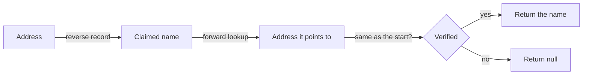

By the end of this guide you can show `vitalik.eth` instead of `0xd8dA…6045`. The name an address picks to represent itself is its **primary name** (stored in a reverse record, which makes this reverse resolution).

## Prerequisites

- An ensforge client with the ENS actions added. See [Create a client](/docs/sdk/create-a-client).

## Get the primary name

`primaryName.get` takes an address and returns its primary name.

**Example** (Showing a Name for an Address)

```ts title="get-primary-name.ts"
import { ensActions, Ensforge } from "@ensforge/sdk";
import { createPublicClient, http } from "viem";
import { mainnet } from "viem/chains";

const ens = Ensforge.create({
  publicClient: createPublicClient({ chain: mainnet, transport: http() }),
}).extend(ensActions());

const address = "0xd8dA6BF26964aF9D7eEd9e03E53415D37aA96045";

const name = await ens.primaryName.get({ address });
console.log(name);
```

```text title="Output"
vitalik.eth
```

The result is a `string`, or `null` when the address has no valid primary name. Show the address itself in that case. See [`primaryName.get`](/docs/reference/sdk/primary-name/get).

## Why a name can come back as `null` even when one is set

Anyone can write any name into their own reverse record, including a name they do not own. ensforge therefore checks the answer in the other direction: the name counts only when it resolves back to the same address. This stops an account from claiming another account's name.



Names that are not normalised are treated as unset. To skip the check and read the raw reverse record, pass `verify: false`. Only do that when you display the name next to the address and never use it to make a trust decision.

## Get the name on another chain

A primary name is stored per chain. `coin` selects the chain. It takes `"eth"` (the default), an EVM chain such as `{ chainId: 8453 }`, or `"default"`.

**Example** (Reading the Base Primary Name)

```ts title="get-base-primary-name.ts"
import { ensActions, Ensforge } from "@ensforge/sdk";
import { createPublicClient, http } from "viem";
import { mainnet } from "viem/chains";

const ens = Ensforge.create({
  publicClient: createPublicClient({ chain: mainnet, transport: http() }),
}).extend(ensActions());

const baseName = await ens.primaryName.get({
  address: "0xd8dA6BF26964aF9D7eEd9e03E53415D37aA96045",
  coin: { chainId: 8453 },
});
```

A chain without its own primary name falls back to the address's default primary name (`default.reverse`, [ENSIP-19](https://docs.ens.domains/ensip/19)). For Ethereum, the name set for Ethereum itself takes priority over the default. To set a primary name, see [Set a primary name](/docs/sdk/set-a-primary-name).

## Options

| Option    | Type                                           | Default  | Description                                      |
| --------- | ---------------------------------------------- | -------- | ------------------------------------------------ |
| `address` | `string`                                       | required | The address to look up.                          |
| `coin`    | symbol, `{ chainId }`, `bigint` or `"default"` | `"eth"`  | The chain whose primary name to read.            |
| `verify`  | `boolean`                                      | `true`   | Require the name to resolve back to the address. |

The action also takes the options every read takes: `signal`, `strict`, `gatewayUrls` and `blockNumber` or `blockTag`.

## Result

The result is the name, or `null` when there is no valid primary name. With `strict: true`, the two ways to have none are told apart:

| Situation                                                                                          | Error                                                                   |
| -------------------------------------------------------------------------------------------------- | ----------------------------------------------------------------------- |
| The address has no reverse name, or its reverse name has no resolver or no name                    | [`PRIMARY_NAME_NOT_SET`](/docs/reference/errors/PRIMARY_NAME_NOT_SET)   |
| The name does not resolve back to the address (no resolver, no address record, or another address) | [`PRIMARY_NAME_MISMATCH`](/docs/reference/errors/PRIMARY_NAME_MISMATCH) |

The `cause` of a mismatch names the name or the profile that failed. A resolver that reverts without data says neither, and counts as not set.

To label many addresses at once, see [Look up many at once](/docs/sdk/look-up-many-at-once).

## Troubleshooting

### The result is `null`

The address has no primary name, or the name it set does not resolve back to it. Pass `strict: true` to get [`PRIMARY_NAME_NOT_SET`](/docs/reference/errors/PRIMARY_NAME_NOT_SET) or [`PRIMARY_NAME_MISMATCH`](/docs/reference/errors/PRIMARY_NAME_MISMATCH). To fix a mismatch, the owner sets the name's address record to the address, or picks another primary name.

### `INVALID_ADDRESS`

The `address` is not a valid address. [`INVALID_ADDRESS`](/docs/reference/errors/INVALID_ADDRESS) is thrown before any request is sent. [`INVALID_COIN_TYPE`](/docs/reference/errors/INVALID_COIN_TYPE) means the `coin` is unknown.

### `GATEWAY_REQUEST_FAILED` on an L2 name

Primary names on other chains can be proven through off-chain gateways, and the gateway failed. See [Look up off-chain names](/docs/sdk/off-chain-names) and [`GATEWAY_REQUEST_FAILED`](/docs/reference/errors/GATEWAY_REQUEST_FAILED).
