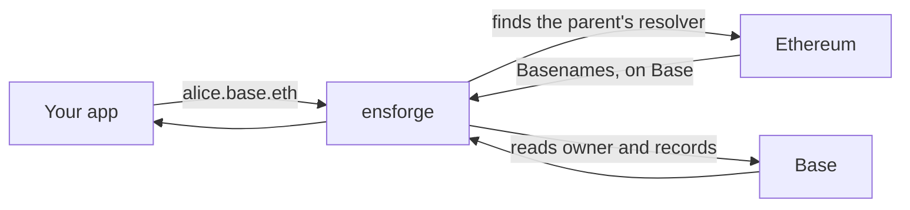

By the end of this guide you can read and change an **L2 name**: a name whose owner and records live on an L2 (a second chain such as Base), not in ENS's registry on Ethereum. `alice.base.eth` is one. Its parent `base.eth` is an ENS name, and its resolver on Ethereum answers for every Basename by asking Base.

## Prerequisites

- An ensforge client with the ENS actions added. See [Create a client](/docs/sdk/create-a-client).
- To write: a wallet that can switch to the name's L2, or a local account.

## Where L2 names live

ensforge supports five L2 namespaces. A **namespace** is a set of names under a parent name, stored by one project's contracts.

| Namespace   | Parent names                                     | L2                     |
| ----------- | ------------------------------------------------ | ---------------------- |
| Basenames   | `base.eth`                                       | Base (8453)            |
| Linea Names | `linea.eth`                                      | Linea (59144)          |
| Celonames   | `celo.eth`                                       | Celo (42220)           |
| Durin       | any second-level name its owner points at Durin  | the L2 its owner chose |
| Namespace   | parent names configured in Namespace's resolvers | Base or OP Mainnet     |

The testnets have Basenames (`basetest.eth`, Base Sepolia), Linea Names (`linea-sepolia.eth`, Linea Sepolia), Durin and Namespace. [Deployments](/docs/reference/contracts/deployments#l2-namespaces) lists every contract.

ensforge finds where a name lives from the resolver its parent sets on Ethereum. You never pass the L2 yourself.



## Read an L2 name

Read it as any other name. The client reads Base through Base's public RPC unless you give it a transport.

**Example** (Reading a Basename)

```ts title="read-basename.ts"
import { ensActions, Ensforge } from "@ensforge/sdk";
import { http } from "viem";
import { base, mainnet } from "viem/chains";

const ens = Ensforge.create({
  chain: mainnet,
  transports: { [base.id]: http("https://base.example/rpc") },
}).extend(ensActions());

const address = await ens.record.getAddress({ name: "jesse.base.eth" });
const state = await ens.name.get({ name: "jesse.base.eth" });
```

- `transports` sets the RPC of any chain. Leave Base out to use its public RPC.
- `state.kind` is `"l2"`, `state.chainId` is `8453`, and `state.namespace` names the namespace, its parent and the registry on Base.
- `state.owner`, `state.expiry` and `state.status` come from Base. A Basename past its expiry is `grace` for 90 days, then `expired`.

[`name.getNamespace`](/docs/reference/sdk/name/get-namespace) returns where a name lives without its state, and `null` for names in ENS.

### When the client cannot reach the L2

With `publicRpc: false` and no transport for the L2, or for an L2 ensforge does not know, reads fall back to Ethereum. Ethereum asks the namespace's gateway, as any ENS client does. `name.get` then reports `status: "external"` with the location only. Pass `strict: true` to fail with [`CHAIN_NOT_CONFIGURED`](/docs/reference/errors/CHAIN_NOT_CONFIGURED) instead.

## Change an L2 name

Writes on an L2 name are planned, simulated and sent on its L2. A wallet is asked to switch chains first; a local account signs on any chain.

| Write                                                                                                                              | Basenames                   | Linea Names                 | Celonames, Durin, Namespace |
| ---------------------------------------------------------------------------------------------------------------------------------- | --------------------------- | --------------------------- | --------------------------- |
| [`record.set`](/docs/reference/sdk/record/set)                                                                                     | yes                         | yes                         | yes                         |
| [`name.transfer`](/docs/reference/sdk/name/transfer)                                                                               | yes                         | yes                         | yes                         |
| [`approval.setToken`](/docs/reference/sdk/approval/set-token), [`approval.setOperator`](/docs/reference/sdk/approval/set-operator) | yes (no token for subnames) | yes                         | yes                         |
| [`resolver.set`](/docs/reference/sdk/resolver/set)                                                                                 | yes                         | Linea's PublicResolver only | no                          |
| [`name.setTtl`](/docs/reference/sdk/name/set-ttl)                                                                                  | yes                         | yes                         | no                          |
| [`subname.create`](/docs/reference/sdk/subname/create), `update`, `remove`                                                         | yes                         | yes                         | no                          |
| [`approval.setDelegate`](/docs/reference/sdk/approval/set-delegate)                                                                | yes                         | yes                         | no                          |

**Example** (Setting Records on a Basename)

```ts title="write-basename.ts"
import { ensActions, Ensforge } from "@ensforge/sdk";
import { http } from "viem";
import { privateKeyToAccount } from "viem/accounts";
import { baseSepolia, sepolia } from "viem/chains";

const ens = Ensforge.create({
  chain: sepolia,
  account: privateKeyToAccount("0x..."),
  transports: { [baseSepolia.id]: http() },
}).extend(ensActions());

const { plan } = await ens.record.setSync({
  name: "yourname.basetest.eth",
  texts: { url: "https://example.com" },
});
```

- `plan.chainId` is `84532`: the plan ran on Base Sepolia.
- The local `account` signs there itself. With a `wallet` instead, the wallet is asked to switch to Base Sepolia.

What each write does on each namespace:

- `name.transfer` moves the name's token. A Basenames second-level name also moves its registry record (`reclaim`) unless `role` is `"registrant"`. A Linea name moves through the NameWrapper.
- `approval.setOperator` and `approval.getOperator` take `name` instead of `contract`, to target the contract that holds that name's token on its L2.
- `subname.create` under a Basenames or Linea name gives the child the family's current resolver by default. With `records` and another `owner`, ensforge writes the records while the signer holds the child, then hands the child to `owner`, in one step.
- A Linea name accepts only Linea's PublicResolver: Linea's resolver on Ethereum reads no other, so another resolver would stop the name resolving.

### What ensforge does not change

Registration, renewal, wrapping and fuses on L2 names belong to each namespace's own app. These writes fail before anything is signed with [`NAME_EXTERNAL`](/docs/reference/errors/NAME_EXTERNAL), and the message says where the name lives:

```text title="Output"
alice.celo.eth lives on Celo (chain 42220) in Celonames. ensforge can change its records, owner and approvals, not this.
```

Other refusals:

- An expired L2 name, or one in its grace period, fails with [`NAME_EXPIRED`](/docs/reference/errors/NAME_EXPIRED). One its L2 does not hold fails with [`NAME_NOT_REGISTERED`](/docs/reference/errors/NAME_NOT_REGISTERED).
- Writes never fall back to Ethereum: an L2 the client cannot reach fails with [`CHAIN_NOT_CONFIGURED`](/docs/reference/errors/CHAIN_NOT_CONFIGURED).
- A route (`via`) is refused for writes on L2 names. Wallet bundles and paymasters still work.

## Check who can change it

[`permission.check`](/docs/reference/sdk/permission/check) and [`permission.get`](/docs/reference/sdk/permission/get) answer as each namespace's contracts decide: the token holder, an approved address or an operator, and resolver delegates on Basenames and Linea. For a Linea name, `permission.get` lists its burned NameWrapper fuses.

## Primary names on L2s

A primary name for Base, OP Mainnet, Arbitrum, Linea or Scroll is set with [`primaryName.set`](/docs/reference/sdk/primary-name/set) and `coin: { chainId }`, and read with [`primaryName.get`](/docs/reference/sdk/primary-name/get). When the client reaches the chain, the read happens there. See [Get a primary name](/docs/sdk/get-a-primary-name).

## Troubleshooting

### A read or write fails with `CHAIN_NOT_CONFIGURED`

The client has no transport for the name's L2 and `publicRpc` is `false`, or the L2 is one ensforge has no public RPC for. Add the L2 to `transports`. The error's `context.chainId` names it.

### A write fails with `NAME_EXTERNAL`

The write is one ensforge does not make on that namespace, or the name is served by an off-chain provider. Use the namespace's own app. See [Look up off-chain names](/docs/sdk/off-chain-names) for names no chain holds.

### Indexer reads fail with `INDEXER_UNSUPPORTED`

No indexer serves Linea Names or Celonames. Read them on-chain with `name.get` and `record.get`. See [Connect an indexer](/docs/sdk/connect-an-indexer).
