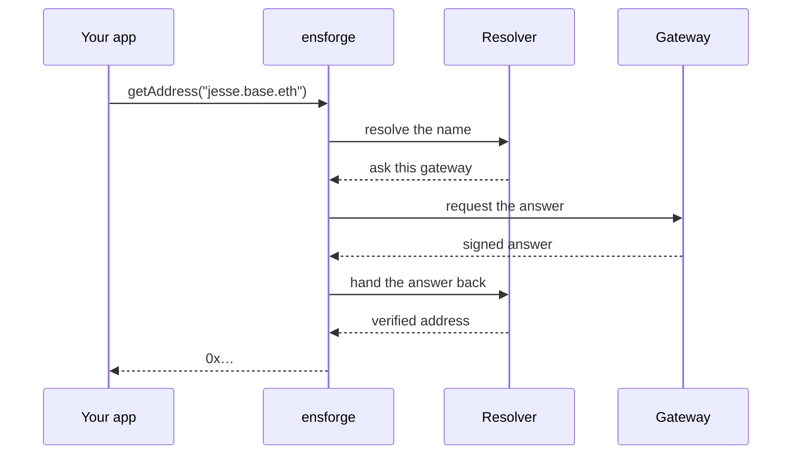

By the end of this guide you can read the records of an **off-chain name** (a name whose records are not stored on Ethereum, but served by a **gateway**) with the same calls you use for any other name, and configure or turn off the gateway lookup.

## Prerequisites

- An ensforge client with the ENS actions added. See [Create a client](/docs/sdk/create-a-client).

## Read an off-chain name

Nothing changes in your code. Ask for a record as usual.

**Example** (Reading an Off-Chain Name)

```ts twoslash title="off-chain.ts"
import { ensActions, Ensforge } from "@ensforge/sdk";
import { createPublicClient, http } from "viem";
import { mainnet } from "viem/chains";

const ens = Ensforge.create({
  publicClient: createPublicClient({ chain: mainnet, transport: http() }),
}).extend(ensActions());

// jesse.base.eth is a subname of an on-chain name, answered off-chain by its parent's resolver.
const address = await ens.record.getAddress({ name: "jesse.base.eth" });
const url = await ens.record.getText({ name: "jesse.base.eth", key: "url" });
```

`record.getAddress`, `record.getText`, `record.get`, `record.getAvatar` and `primaryName.get` all follow an off-chain lookup when the name needs one. See [Get a name's address](/docs/sdk/get-an-address).

## How an off-chain lookup works

The name's resolver does not hold the answer. It replies with a request to ask a gateway ([CCIP-Read, EIP-3668](https://eips.ethereum.org/EIPS/eip-3668)). ensforge asks the gateway and hands its answer back to the resolver contract, which checks it and returns the result.



Two kinds of name need this:

- A name with an off-chain resolver of its own.
- A name that has no resolver of its own, where a parent's **wildcard resolver** ([ENSIP-10](https://docs.ens.domains/ensip/10)) answers for every subname. `jesse.base.eth` is one.

ensforge only follows a lookup that the resolver it called asked for. If a resolver sends a lookup that names another contract as the sender, ensforge refuses it with [`OFFCHAIN_LOOKUP_INVALID`](/docs/sdk/errors/OFFCHAIN_LOOKUP_INVALID) and never returns the gateway's answer. See [How a lookup works](/docs/sdk/looking-up-a-name).

## Choose the gateways

By default, ensforge uses the Universal Resolver's own gateway. To use your own, set `ccipRead` when you create the client, or `gatewayUrls` on one call.

**Example** (Setting CCIP-Read Gateways)

```ts twoslash title="gateways.ts"
import { ensActions, Ensforge } from "@ensforge/sdk";
import { createPublicClient, http } from "viem";
import { mainnet } from "viem/chains";

const publicClient = createPublicClient({ chain: mainnet, transport: http() });

// For every call made with this client.
const ens = Ensforge.create({
  publicClient,
  ccipRead: { gatewayUrls: ["https://ccip.example.com"] },
}).extend(ensActions());

// For one call only.
const address = await ens.record.getAddress({
  name: "jesse.base.eth",
  gatewayUrls: ["https://ccip.example.com"],
});
```

A call's `gatewayUrls` override the client's. To read through the chain only, pass `ccipRead: false` to `Ensforge.create`. Off-chain names then fail with [`CCIP_READ_DISABLED`](/docs/sdk/errors/CCIP_READ_DISABLED).

## Options

| Option        | Where             | Type                          | Default                              | Description                                             |
| ------------- | ----------------- | ----------------------------- | ------------------------------------ | ------------------------------------------------------- |
| `ccipRead`    | `Ensforge.create` | `{ gatewayUrls? }` or `false` | the Universal Resolver's own gateway | Gateways for off-chain lookups. `false` turns them off. |
| `gatewayUrls` | any read          | `readonly string[]`           | the client's                         | Gateways for one call.                                  |

## Names that are in no registry

A name served only by a parent's resolver is in no registry. [`name.get`](/docs/sdk/reference/actions/name/get) reports `resolver: null` and `status: "available"` for it, although it resolves. Its `inheritedResolver` is the resolver that serves it. See [Get a name's owner, expiry and status](/docs/sdk/get-name-details).

## Troubleshooting

### `GATEWAY_REQUEST_FAILED`

The gateway could not be reached, or answered with an error status. The error carries the HTTP `status` and the gateway `url` when there is one. It is the one gateway failure ensforge marks as retryable. See [`GATEWAY_REQUEST_FAILED`](/docs/sdk/errors/GATEWAY_REQUEST_FAILED).

### `GATEWAY_RESPONSE_INVALID`

The gateway answered with something ensforge cannot use. Retrying the same gateway does not help. See [`GATEWAY_RESPONSE_INVALID`](/docs/sdk/errors/GATEWAY_RESPONSE_INVALID).

### `CCIP_READ_DISABLED`

The name resolves off-chain and the client was created with `ccipRead: false`. Remove that option. See [`CCIP_READ_DISABLED`](/docs/sdk/errors/CCIP_READ_DISABLED).

### `OFFCHAIN_LOOKUP_INVALID`

The resolver asked for a lookup from an unexpected sender. ensforge refuses these on purpose. See [`OFFCHAIN_LOOKUP_INVALID`](/docs/sdk/errors/OFFCHAIN_LOOKUP_INVALID).

### `DNSSEC_PROOF_FAILED` on a DNS name

Imported DNS names, such as `ens.domains`, resolve through DNSSEC proofs. At the time of writing, no proof verifies on-chain on Ethereum mainnet or Sepolia, so these reads fail with [`DNSSEC_PROOF_FAILED`](/docs/sdk/errors/DNSSEC_PROOF_FAILED) until ENS updates its DNSSEC trust anchor. See [Use a DNS name](/docs/sdk/use-a-dns-name).

### Writing records to an off-chain name fails

Resolvers that keep records off-chain refuse on-chain writes. The write fails with [`RESOLVER_PROFILE_UNSUPPORTED`](/docs/sdk/errors/RESOLVER_PROFILE_UNSUPPORTED) and says where the records live. See [Set records](/docs/sdk/set-records).
