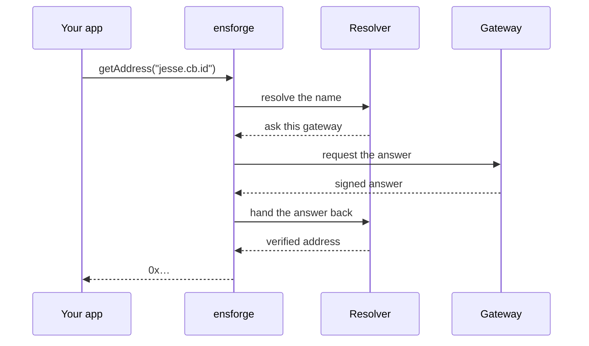

By the end of this guide you can read the records of an **off-chain name** (a name whose records are not stored on any chain, but served by a **gateway** from a provider's database) with the same calls you use for any other name, find the provider, and configure or turn off the gateway lookup ([CCIP-Read](/docs/reference/glossary#ccip-read)). `jesse.cb.id` is one: Coinbase serves it.

Names on an L2, such as Basenames, are not off-chain names: ensforge reads them on their L2. See [Work with names on L2s](/docs/sdk/names-on-l2s).

## Prerequisites

- An ensforge client with the ENS actions added. See [Create a client](/docs/sdk/create-a-client).

## Read an off-chain name

Nothing changes in your code. Ask for a record as usual.

**Example** (Reading an Off-Chain Name)

```ts title="off-chain.ts"
import { ensActions, Ensforge } from "@ensforge/sdk";
import { mainnet } from "viem/chains";

const ens = Ensforge.create({
  chain: mainnet,
}).extend(ensActions());

// jesse.cb.id is served by Coinbase's gateway, through cb.id's resolver on Ethereum.
const address = await ens.record.getAddress({ name: "jesse.cb.id" });
const url = await ens.record.getText({ name: "jesse.cb.id", key: "url" });
```

`record.getAddress`, `record.getText`, `record.get`, `record.getAvatar`, `record.getContentHash` and `primaryName.get` all follow an off-chain lookup when the name needs one. See [Get a name's address](/docs/sdk/get-an-address).

## How an off-chain lookup works

The name's [resolver](/docs/reference/glossary#resolver) does not hold the answer. It replies with a request to ask a gateway ([CCIP-Read, EIP-3668](https://eips.ethereum.org/EIPS/eip-3668)). ensforge asks the gateway and hands its answer back to the resolver contract, which checks it and returns the result.



Two kinds of name need this:

- A name with an off-chain resolver of its own.
- A name that has no resolver of its own, where a parent's **wildcard resolver** ([ENSIP-10](https://docs.ens.domains/ensip/10)) answers for every subname. `jesse.cb.id` is one.

ensforge only follows a lookup that the resolver it called asked for. If a resolver sends a lookup that names another contract as the sender, ensforge refuses it with [`OFFCHAIN_LOOKUP_INVALID`](/docs/reference/errors/OFFCHAIN_LOOKUP_INVALID) and never returns the gateway's answer. See [How a lookup works](/docs/sdk/looking-up-a-name).

## Choose the gateways

The Universal Resolver sends off-chain lookups through a batch gateway, which collects them and forwards each one to the resolver's own gateway. By default, ensforge uses the Universal Resolver's own batch gateway. To use batch gateways you choose, set `ccipRead` when you create the client, or `gatewayUrls` on one call. The resolver's own gateway is set by the resolver and cannot be changed.

`x-batch-gateway:true` makes viem answer the batch itself. A URL works too, for a batch gateway you run. See [Configure RPC and gateways](/docs/sdk/rpc-and-gateways#set-off-chain-lookup-gateways).

**Example** (Setting Batch Gateways)

```ts title="gateways.ts"
import { ensActions, Ensforge } from "@ensforge/sdk";
import { mainnet } from "viem/chains";

// For every call made with this client.
const ens = Ensforge.create({
  chain: mainnet,
  ccipRead: { gatewayUrls: ["x-batch-gateway:true"] },
}).extend(ensActions());

// For one call only.
const address = await ens.record.getAddress({
  name: "jesse.cb.id",
  gatewayUrls: ["x-batch-gateway:true"],
});
```

A call's `gatewayUrls` override the client's. To read through the chain only, pass `ccipRead: false` to `Ensforge.create`. Off-chain names then fail with [`CCIP_READ_DISABLED`](/docs/reference/errors/CCIP_READ_DISABLED).

## Options

| Option        | Where             | Type                          | Default                                    | Description                                                   |
| ------------- | ----------------- | ----------------------------- | ------------------------------------------ | ------------------------------------------------------------- |
| `ccipRead`    | `Ensforge.create` | `{ gatewayUrls? }` or `false` | the Universal Resolver's own batch gateway | Batch gateways for off-chain lookups. `false` turns them off. |
| `gatewayUrls` | any read          | `readonly string[]`           | the client's                               | Batch gateways for one call.                                  |

## Find the provider

[`name.get`](/docs/reference/sdk/name/get) reports a name only a parent's resolver serves as `kind: "offchain"` (a gateway answers) or `kind: "wildcard"` (an on-chain resolver answers), with `status: "external"` and `available: false`. Its `inheritedResolver` is the resolver that serves it. For an off-chain name, `namespace.provider` names the provider when ensforge knows its resolver, and `namespace.parent` names the parent that serves it.

**Example** (Finding the Provider)

```ts title="provider.ts"
import { ensActions, Ensforge } from "@ensforge/sdk";
import { mainnet } from "viem/chains";

const ens = Ensforge.create({ chain: mainnet }).extend(ensActions());

const located = await ens.name.getNamespace({ name: "jesse.cb.id" });
// { kind: "offchain", provider: { id: "coinbase", name: "Coinbase", … }, parent: "cb.id" }
```

`provider` is `null` for a gateway ensforge does not list. `Deployments.offchainProviders` in `@ensforge/contracts` lists the known providers, their parent names, resolvers, gateways and whether each gateway answered when the list was last checked. See [Deployments](/docs/reference/contracts/deployments#off-chain-providers).

## Off-chain names are read-only

ensforge cannot change an off-chain name: its records live in the provider's database, which only the provider's app or API changes. Writes fail before anything is signed with [`NAME_EXTERNAL`](/docs/reference/errors/NAME_EXTERNAL), and the message names the provider:

```text title="Output"
jesse.cb.id is served by Coinbase from its own database. ensforge can read it, not write it.
```

## Troubleshooting

### `GATEWAY_REQUEST_FAILED`

The gateway could not be reached, or answered with an error status. The error carries the HTTP `status` and the gateway `url` when there is one. It is the one gateway failure ensforge marks as retryable. See [`GATEWAY_REQUEST_FAILED`](/docs/reference/errors/GATEWAY_REQUEST_FAILED).

### `GATEWAY_RESPONSE_INVALID`

The gateway answered with something ensforge cannot use. Retrying the same gateway does not help. See [`GATEWAY_RESPONSE_INVALID`](/docs/reference/errors/GATEWAY_RESPONSE_INVALID).

### `CCIP_READ_DISABLED`

The name resolves off-chain and the client was created with `ccipRead: false`. Remove that option. See [`CCIP_READ_DISABLED`](/docs/reference/errors/CCIP_READ_DISABLED).

### `OFFCHAIN_LOOKUP_INVALID`

The resolver asked for a lookup from an unexpected sender. ensforge refuses these on purpose. See [`OFFCHAIN_LOOKUP_INVALID`](/docs/reference/errors/OFFCHAIN_LOOKUP_INVALID).

### `DNSSEC_PROOF_FAILED` on a DNS name

DNS names without a resolver of their own in ENS, such as `ens.domains`, resolve through DNSSEC proofs. At the time of writing, no proof verifies on-chain on Ethereum mainnet or Sepolia, so these reads fail with [`DNSSEC_PROOF_FAILED`](/docs/reference/errors/DNSSEC_PROOF_FAILED) until ENS updates its DNSSEC trust anchor. See [Use a DNS name](/docs/sdk/use-a-dns-name).

### Writing records to an off-chain name fails

Resolvers that keep records off-chain refuse on-chain writes. The write fails with [`RESOLVER_PROFILE_UNSUPPORTED`](/docs/reference/errors/RESOLVER_PROFILE_UNSUPPORTED) and says where the records live. See [Set records](/docs/sdk/set-records).
