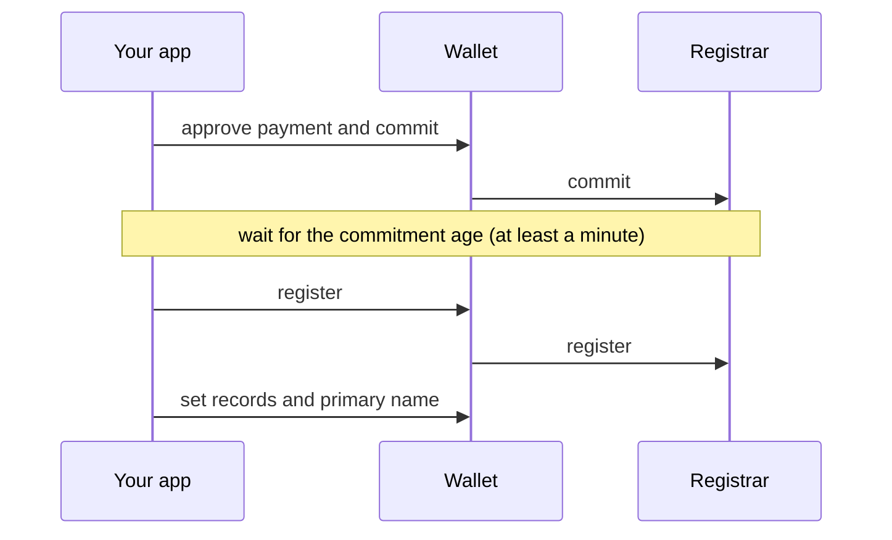

You will register a `.eth` **name** you own, paying in an ERC-20 token. A registration is a **commit-reveal** flow: you first commit to the registration, wait on-chain for the commitment to age, then register. This stops anyone from front-running your name.

ensforge runs the whole flow as one plan. Every new `.eth` name is registered on ENSv2, so you never choose a version.

## Prerequisites

- A wallet client that holds the payment token and gas. See [Create a client](/docs/sdk/create-a-client).
- A chain with ENSv2 deployed. The examples use Sepolia and a placeholder name. Never test with a mainnet name you care about.
- A name that is available. See [Check if a name is available](/docs/sdk/check-if-a-name-is-available).

## How the flow works

The plan has up to five steps. The wait is measured in chain time, so ensforge cannot skip it.



| Step id       | What it sends                                                                     |
| ------------- | --------------------------------------------------------------------------------- |
| `approve`     | The token approval, only when the commit step does not already carry it.          |
| `commit`      | The token approval (when the allowance is short) and the commitment.              |
| `register`    | Deploys each name's resolver, then registers. Waits for the commitment age first. |
| `records`     | Records on the owner's resolver, when `resolver` is explicit.                     |
| `primaryName` | The reverse record, when `primaryName` is set.                                    |

By default each name gets its own resolver, deployed in the `register` step with `records` written at creation. See [Resolvers and shared records](/docs/sdk/resolvers-and-shared-records).

## 1. Register and wait

[`registration.registerSync`](/docs/sdk/reference/actions/registration/register) sends every step and resolves after the last receipt. [`registration.register`](/docs/sdk/reference/actions/registration/register) resolves as soon as the last transaction is submitted.

**Example** (Registering With Records and a Primary Name)

```ts twoslash title="register.ts"
// @types: node
import { createPublicClient, createWalletClient, http, type Hex } from "viem";
import { privateKeyToAccount } from "viem/accounts";
import { sepolia } from "viem/chains";
import { Duration, Ensforge, ensActions } from "@ensforge/sdk";

const account = privateKeyToAccount(process.env.PRIVATE_KEY as Hex);
const transport = http(process.env.SEPOLIA_RPC_URL);

const ens = Ensforge.create({
  publicClient: createPublicClient({ chain: sepolia, transport }),
  walletClient: createWalletClient({ account, chain: sepolia, transport }),
}).extend(ensActions());

const { names, paid, secret } = await ens.registration.registerSync({
  names: "ensforge-docs-demo.eth",
  duration: Duration.years(1),
  records: { texts: { url: "https://example.com" } },
  primaryName: true,
  onStep: (event) => console.log(event.step.id, event.status),
});
```

- `names` takes one name or an array. Several names share one plan.
- `records` are written when each name's resolver is created. Their shape is the one `record.set` takes. See [Set records](/docs/sdk/set-records).
- `primaryName: true` sets the single name as the signer's primary name and adds its `eth` address record. It needs exactly one name, owned by the signer. See [Set a primary name](/docs/sdk/set-a-primary-name).
- `onStep` is called as each step waits, is submitted, is confirmed or fails.
- The wallet prompts once per step, or once for several steps when it supports EIP-5792 batches. See [Send a transaction](/docs/sdk/send-a-transaction).

## 2. Read the result

`registerSync` returns the receipts, the registered names and what you paid.

| Field                    | Description                                                                          |
| ------------------------ | ------------------------------------------------------------------------------------ |
| `names`                  | One entry per name: `name` (normalised), `tokenId` and `expiry` as a Unix timestamp. |
| `paid`                   | The amount charged, in the payment token's smallest unit.                            |
| `secret`                 | The commitment secret. Keep it if you may need to resume.                            |
| `receipt`, `receipts`    | The last receipt, and every receipt in order.                                        |
| `hash`, `hashes`, `plan` | The submitted hashes and the plan that produced them.                                |

## Options

| Option         | Type                        | Default                 | Description                                                                       |
| -------------- | --------------------------- | ----------------------- | --------------------------------------------------------------------------------- |
| `names`        | `string \| string[]`        | required                | `.eth` second-level names. Normalised automatically.                              |
| `duration`     | `bigint`                    | required                | Length in seconds. Use `Duration.years(1)`.                                       |
| `owner`        | `string`                    | the signer              | Owner of the names.                                                               |
| `resolver`     | `string \| null`            | a new resolver per name | `"owned"` uses the signer's shared resolver. `null` registers without a resolver. |
| `records`      | `object`                    | none                    | Records for every name.                                                           |
| `primaryName`  | `boolean`                   | `false`                 | Set the single name as the signer's primary name.                                 |
| `paymentToken` | `"usdc" \| "dai" \| string` | `"usdc"`                | Token to pay with. The registrar does not accept ETH.                             |
| `subregistry`  | `string`                    | none                    | ENSv2 registry for the names' subnames.                                           |
| `referrer`     | `Hex`                       | none                    | Referrer the registrar records: 32 bytes, or an address.                          |
| `secret`       | `Hex`                       | a random secret         | Secret from an earlier `commit` or `register`, to finish that registration.       |

All write options also apply: `account`, `simulate`, `signal`, `mode`, `onStep`, `via` and `paymaster`. See [How writes work](/docs/sdk/writing-to-ens).

The approval covers the quote plus 2%, because the price is charged at `register` and can drift, for example while a premium decays. You pay only the actual price.

## Split the flow across sessions

[`registration.commit`](/docs/sdk/reference/actions/registration/commit) sends only the first half. Use it when the user commits now and finishes later, or on another device. Keep the returned `secret`, then call `register` with exactly the same options and the `secret`.

**Example** (Committing Now and Registering Later)

```ts twoslash title="commit-then-register.ts"
// @types: node
import { createPublicClient, createWalletClient, http, type Hex } from "viem";
import { privateKeyToAccount } from "viem/accounts";
import { sepolia } from "viem/chains";
import { Duration, Ensforge, ensActions } from "@ensforge/sdk";

const account = privateKeyToAccount(process.env.PRIVATE_KEY as Hex);
const transport = http(process.env.SEPOLIA_RPC_URL);

const ens = Ensforge.create({
  publicClient: createPublicClient({ chain: sepolia, transport }),
  walletClient: createWalletClient({ account, chain: sepolia, transport }),
}).extend(ensActions());

// ---cut---
const options = { names: "ensforge-docs-demo.eth", duration: Duration.years(1) };

const { secret, commitments } = await ens.registration.commitSync(options);

// Later, once the commitment is ready:
const [commitment] = commitments;
if (commitment === undefined) throw new Error("no commitment");
const { status } = await ens.registration.getCommitmentStatus({ commitment });

if (status === "ready") {
  await ens.registration.registerSync({ ...options, secret });
}
```

[`registration.getCommitmentStatus`](/docs/sdk/reference/actions/registration/get-commitment-status) reports where the commitment is in its window.

| `status`  | Meaning                                               |
| --------- | ----------------------------------------------------- |
| `pending` | Too new to register. `readyAt` says when it is ready. |
| `ready`   | Register now.                                         |
| `expired` | The window passed. Commit again.                      |
| `unknown` | Never made, or already used by a registration.        |

Resuming needs the same options, because they are part of the commitment. With a valid `secret`, only the `register` step is left to send.

<Callout type="warn" title="Resume with the same options">
  The options are hashed into the commitment. Change the owner, resolver, records or duration and
  the original commitment no longer matches.
</Callout>

## Preview before you pay

`registration.register.prepare`, `.simulate` and `.estimateGas` build, simulate and price the plan without sending anything. See [Preview before sending](/docs/sdk/preview-before-sending).

## Troubleshooting

### `NAME_NOT_AVAILABLE`

The name is registered or in its grace period. Check it first. See [`NAME_NOT_AVAILABLE`](/docs/sdk/errors/NAME_NOT_AVAILABLE).

### `INSUFFICIENT_TOKEN_BALANCE`

The signer cannot pay the quote in the payment token. Fund the account, or pick another `paymentToken`. See [`INSUFFICIENT_TOKEN_BALANCE`](/docs/sdk/errors/INSUFFICIENT_TOKEN_BALANCE).

### `COMMITMENT_TOO_NEW`

You resumed before the commitment aged. The error's `readyAt` is the Unix time from which `register` works. See [`COMMITMENT_TOO_NEW`](/docs/sdk/errors/COMMITMENT_TOO_NEW).

### `COMMITMENT_TOO_OLD`

The commitment expired before you registered. Commit again. See [`COMMITMENT_TOO_OLD`](/docs/sdk/errors/COMMITMENT_TOO_OLD).

### `COMMITMENT_EXISTS`

An unexpired commitment with the same data already exists. Resume it with its `secret` instead of committing again. See [`COMMITMENT_EXISTS`](/docs/sdk/errors/COMMITMENT_EXISTS).

### `DURATION_TOO_SHORT`

`duration` is shorter than the registrar's minimum. Read `minDuration` from `registration.getParameters`. See [`DURATION_TOO_SHORT`](/docs/sdk/errors/DURATION_TOO_SHORT).

### `PAYMENT_TOKEN_UNSUPPORTED`

The registrar does not accept `paymentToken`. See [`PAYMENT_TOKEN_UNSUPPORTED`](/docs/sdk/errors/PAYMENT_TOKEN_UNSUPPORTED).

### `WALLET_NOT_CONFIGURED`

The client has no wallet client and you passed no `account`. Pass `walletClient` to `Ensforge.create`. See [`WALLET_NOT_CONFIGURED`](/docs/sdk/errors/WALLET_NOT_CONFIGURED).

### `RECEIPT_TIMEOUT` or `TRANSACTION_REVERTED`

`registerSync` stopped waiting, or a transaction reverted. A timed-out transaction may still confirm: check it by hash before retrying. See [Continue after a failure](/docs/sdk/continue-after-a-failure), [`RECEIPT_TIMEOUT`](/docs/sdk/errors/RECEIPT_TIMEOUT) and [`TRANSACTION_REVERTED`](/docs/sdk/errors/TRANSACTION_REVERTED).

### The register step reverts after the wait

If `owner` is a contract that rejects ERC-1155 tokens, the register step reverts after the commit was already sent. Use an owner that can receive them, such as an account or a contract that implements `onERC1155Received`.
