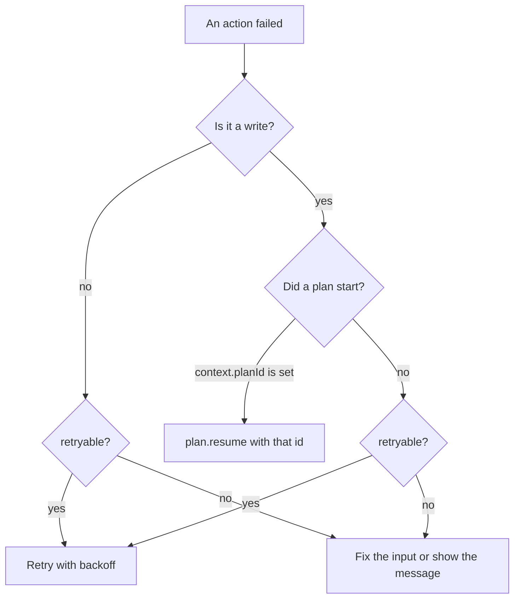

Every action fails with an ensforge error that has a stable `code`. This guide shows how to catch
them, what to show users, and when a retry is safe. For the ideas behind it, see
[How errors work](/docs/sdk/errors-explained).

## Prerequisites

- An `ens` client. See [Create a client](/docs/sdk/create-a-client).

## 1. Catch an error

All errors extend `EnsforgeError`, which extends the native `Error`. Check with `Errors.is`, then
read the fields.

**Example** (Reading the fields of an error)

```ts title="catch.ts"
import { Ensforge, Errors, ensActions } from "@ensforge/sdk";
import { createPublicClient, http } from "viem";
import { mainnet } from "viem/chains";

const publicClient = createPublicClient({ chain: mainnet, transport: http() });
const ens = Ensforge.create({ publicClient }).extend(ensActions());

try {
  await ens.record.getAddress({ name: "nobody-here.eth", strict: true });
} catch (error) {
  if (Errors.is(error)) {
    console.log(error.code); // "RESOLVER_NOT_FOUND": the name has no resolver
    console.log(error.shortMessage); // one line for developers
    console.log(error.hint); // how to fix it, when ensforge knows
    console.log(error.retryable); // whether the same call can succeed later
    console.log(error.docsUrl); // /docs/reference/errors/<CODE>
  }
}
```

| Field          | Description                                                                                                                   |
| -------------- | ----------------------------------------------------------------------------------------------------------------------------- |
| `_tag`         | The class name, such as `"NotFoundError"`. Also `error.name`.                                                                 |
| `code`         | What happened, exactly. Stable across releases.                                                                               |
| `shortMessage` | One developer-facing line.                                                                                                    |
| `hint`         | How to fix it, when ensforge knows.                                                                                           |
| `details`      | Extra developer-facing lines.                                                                                                 |
| `retryable`    | Whether retrying the same call can succeed.                                                                                   |
| `context`      | Where it happened: `operation`, `name`, `account`, `chainId`, `contract`, `functionName`, and for writes `planId` and `step`. |
| `docsUrl`      | The page for this code.                                                                                                       |

`error.toJSON()` returns these fields as plain data that is safe to log or send to an error
tracker. `Errors.is` uses a brand, not `instanceof`, so it also works when two copies of
`@ensforge/sdk` are installed.

## 2. Branch on the code

`Errors.hasCode` takes one or more codes and narrows the error to the class that carries them.

**Example** (Offering alternatives for a taken name)

```ts title="branch.ts"
import { Duration, Ensforge, Errors, ensActions } from "@ensforge/sdk";
import { createPublicClient, http } from "viem";
import { sepolia } from "viem/chains";

const publicClient = createPublicClient({ chain: sepolia, transport: http() });
const account = "0xA11Ce00000000000000000000000000000000000";
const ens = Ensforge.create({ publicClient, account }).extend(ensActions());

try {
  await ens.registration.register({ names: "ensforge-docs-demo.eth", duration: Duration.years(1) });
} catch (error) {
  if (Errors.hasCode("NAME_NOT_AVAILABLE", "NAME_RESERVED")(error)) {
    console.log(error.context.name, "cannot be registered");
  } else if (Errors.hasCode("USER_REJECTED")(error)) {
    // a normal outcome, not a failure
  } else {
    throw error;
  }
}
```

Each action also lists the errors it can fail with, as `ErrorType` on its namespace
(`record.set.ErrorType`). They are narrowed by class, so `switch (error._tag)` is exhaustive over
the classes an action declares. [Route](/docs/reference/glossary#route) errors, such as `HcaError` from `via: hca()`, are outside
those unions.

Two codes can come from any action. [`CONTRACT_NOT_DEPLOYED`](/docs/reference/errors/CONTRACT_NOT_DEPLOYED)
means the chain has no ENS contract at the address the action calls, usually a client on the wrong
chain. [`INSUFFICIENT_ETH`](/docs/reference/errors/INSUFFICIENT_ETH) means the account cannot pay for a
write's gas or value. Handle both in one place, next to your other generic errors.

## 3. Show users a safe message

`error.message` is written for developers and includes contract details. Use `Errors.describe` for
anything a user sees. It accepts any thrown value and returns a title, a message and a suggested
action.

**Example** (An error toast)

```ts title="describe.ts"
import { Errors } from "@ensforge/sdk";

declare const toast: (toast: { title: string; description: string }) => void;
declare const error: unknown;

const { title, message, action, severity, retryable } = Errors.describe(error);

toast({ title, description: action === undefined ? message : `${message} ${action}` });
```

`severity` is `"info"` for expected outcomes (`USER_REJECTED`, name state, not found and commitment
errors), `"warning"` for a retryable failure, and `"error"` for anything that needs attention.

**Example** (Translating one code)

```ts title="translate.ts"
import { Errors } from "@ensforge/sdk";

declare const error: unknown;

const copy = Errors.describe(error, {
  messages: {
    NAME_NOT_AVAILABLE: (e) => ({
      title: "Nombre no disponible",
      message: `${e.context.name} ya está registrado.`,
    }),
  },
});
```

An override returns only the fields it changes. The rest fall back to the English copy.

`Errors.describe` has copy for every code, including the HCA codes. For a code it does not know,
such as one from a newer release, it returns a generic message instead of throwing, so it is safe in
an error boundary.

## 4. Decide whether to retry

Retry only when `error.retryable` is `true`. ensforge sets it for transient failures:

- every `NetworkError` code: `RPC_REQUEST_FAILED`, `RPC_TIMEOUT`, `RATE_LIMITED`,
  `LOG_RANGE_TOO_LARGE`
- the `IndexerError` codes `INDEXER_UNAVAILABLE`, `INDEXER_RATE_LIMITED` and `INDEXER_BEHIND`, from an
  [indexer](/docs/reference/glossary#indexer)
- `GATEWAY_REQUEST_FAILED`, when an off-chain [gateway](/docs/reference/glossary#gateway) did not answer
- `COMMITMENT_TOO_NEW`, when a registration's [commitment](/docs/reference/glossary#commitment) needs more time to age
- `NONCE_CONFLICT`, when another transaction from the account is still pending
- the HCA code `HCA_BUNDLER_REJECTED`



<Callout type="warn" title="Never retry a write by sending it again">
  A write that failed after a step was submitted has already spent gas. Sending it again can repeat
  that step. Resume the [plan](/docs/reference/glossary#plan) instead: it confirms the finished
  steps and sends the rest. See [Continue after a failure](/docs/sdk/continue-after-a-failure).
</Callout>

**Example** (Retrying a read with backoff)

```ts title="retry.ts"
import { Ensforge, Errors, ensActions } from "@ensforge/sdk";
import { createPublicClient, http } from "viem";
import { mainnet } from "viem/chains";

const publicClient = createPublicClient({ chain: mainnet, transport: http() });
const ens = Ensforge.create({ publicClient }).extend(ensActions());

const withRetry = async <value>(run: () => Promise<value>, attempts = 3): Promise<value> => {
  for (let attempt = 1; ; attempt++) {
    try {
      return await run();
    } catch (error) {
      if (attempt >= attempts || !Errors.is(error) || !error.retryable) throw error;
      await new Promise((resolve) => setTimeout(resolve, 2 ** attempt * 250));
    }
  }
};

const address = await withRetry(() => ens.record.getAddress({ name: "nick.eth" }));
```

For a write that timed out waiting for a receipt ([`RECEIPT_TIMEOUT`](/docs/reference/errors/RECEIPT_TIMEOUT)),
`retryable` is `false` on purpose. The transaction may still land. Check its hash before you act.

## Reads return `null`, not errors, for missing data

Reads return `null` when a [record](/docs/reference/glossary#record) or [resolver](/docs/reference/glossary#resolver) is missing. Pass `strict: true` to get a
`NotFoundError` instead, such as [`RECORD_NOT_FOUND`](/docs/reference/errors/RECORD_NOT_FOUND) or
[`RESOLVER_NOT_FOUND`](/docs/reference/errors/RESOLVER_NOT_FOUND).

## Translate errors from viem

When you call viem next to ensforge, `Errors.fromCause(cause, context)` gives the same classes,
codes and `Errors.describe` copy. Anything it does not recognise becomes
[`UNEXPECTED`](/docs/reference/errors/UNEXPECTED), with the original error as `cause`.

## Point `docsUrl` at your own docs

`docsUrl` uses `https://ensforge.com` by default. For a self-hosted mirror, call
`Errors.setConfig({ docsOrigin: "https://docs.example.com" })` once at startup.

## Check the result

Trigger a known failure, such as a read with `strict: true` on a missing record, and confirm that
`Errors.describe` returns copy you are happy to show.

## Troubleshooting

### `UNEXPECTED`

ensforge could not classify the failure. The original error is in `error.cause`. See
[`UNEXPECTED`](/docs/reference/errors/UNEXPECTED), and open an issue with the `cause` and `context`.

### `RATE_LIMITED` or `RPC_TIMEOUT`

Your RPC provider is limiting or slow. Retry with backoff, or use a provider with higher limits.
See [Configure RPC and gateways](/docs/sdk/rpc-and-gateways), [`RATE_LIMITED`](/docs/reference/errors/RATE_LIMITED)
and [`RPC_TIMEOUT`](/docs/reference/errors/RPC_TIMEOUT).

For symptoms by message, see [Troubleshooting](/docs/sdk/troubleshooting).
