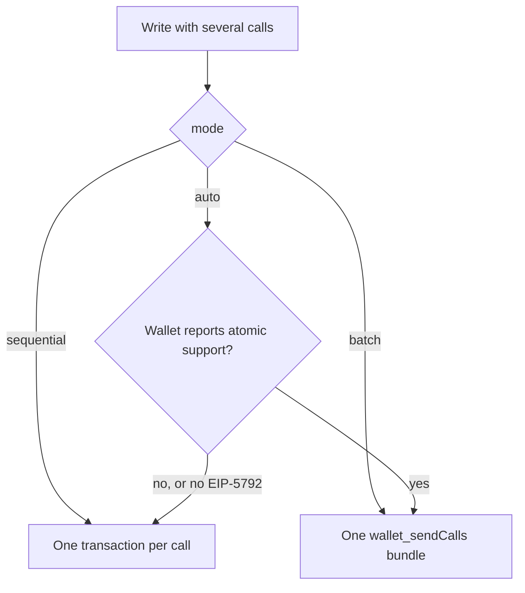

A **bundle** (EIP-5792) is a group of calls a wallet sends together after one approval. ensforge
bundles the [steps](/docs/sdk/reference/glossary#step) of a write for you when the wallet supports it, and `Plan.merge` lets you bundle
several writes into one [plan](/docs/sdk/reference/glossary#plan).

## Prerequisites

- A client with a wallet. See [Send a transaction](/docs/sdk/send-a-transaction).
- A wallet that supports EIP-5792 atomic batches for the bundle to form. Other wallets still work;
  ensforge falls back to one transaction per call.

## How ensforge picks a mode

Every write takes `mode`. The default, `"auto"`, asks the wallet what it supports and chooses.



| Mode           | What it does                                                                                               |
| -------------- | ---------------------------------------------------------------------------------------------------------- |
| `"auto"`       | Sends one atomic bundle when the wallet reports `atomic` support, otherwise one transaction per call.      |
| `"batch"`      | Always sends through `wallet_sendCalls`, even for a single call, and asks the wallet for an atomic bundle. |
| `"sequential"` | Sends one transaction per call. Each waits for the previous receipt, with a fifth more gas than estimated. |

`"auto"` only bundles when the wallet already sends atomic bundles. A wallet that would first ask
the user to upgrade the account (EIP-7702) is treated as unsupported. `mode: "batch"` does not make
that distinction, so the wallet may show the upgrade prompt.

Without a bundle, the calls of a step go out one at a time, because a later call may depend on an
earlier one, such as a payment after its approval.

## Send a write as a bundle

Nothing changes in your code. A write with several calls bundles itself.

**Example** (Forcing one bundle)

```ts title="bundle.ts"
import type { EIP1193Provider } from "viem";

declare global {
  interface Window {
    ethereum?: EIP1193Provider;
  }
}

import { Ensforge, ensActions } from "@ensforge/sdk";
import { createPublicClient, createWalletClient, custom, http } from "viem";
import { sepolia } from "viem/chains";

const publicClient = createPublicClient({ chain: sepolia, transport: http() });
const walletClient = createWalletClient({ chain: sepolia, transport: custom(window.ethereum!) });
const [account] = await walletClient.requestAddresses();
const ens = Ensforge.create({ publicClient, walletClient, account }).extend(ensActions());

const { id, hashes } = await ens.record.set({
  name: "alice.eth",
  texts: { url: "https://alice.dev", "com.twitter": "alice" },
  mode: "batch",
});
```

`id` is the bundle id. A bundle has no transaction hash until it is included, so the write waits
for the bundle to settle before it resolves, and `hashes` holds the transactions it landed in. A
bundle that reverts fails with [`TRANSACTION_REVERTED`](/docs/sdk/errors/TRANSACTION_REVERTED).
Without a `timeout` ensforge waits five minutes, then fails with
[`RECEIPT_TIMEOUT`](/docs/sdk/errors/RECEIPT_TIMEOUT).

## Share one bundle across steps

Consecutive steps without a chain-time wait join one bundle, up to `maxBundleCalls` calls (default
10, the limit MetaMask accepts). A step that waits, such as a registration's register step, starts a
new bundle. Raise `maxBundleCalls` for wallets that accept more.

```ts title="max-bundle-calls.ts"
import type { EIP1193Provider } from "viem";

declare global {
  interface Window {
    ethereum?: EIP1193Provider;
  }
}

import { Ensforge, ensActions } from "@ensforge/sdk";
import { createPublicClient, createWalletClient, custom, http } from "viem";
import { sepolia } from "viem/chains";

const publicClient = createPublicClient({ chain: sepolia, transport: http() });
const walletClient = createWalletClient({ chain: sepolia, transport: custom(window.ethereum!) });
const [account] = await walletClient.requestAddresses();
const ens = Ensforge.create({ publicClient, walletClient, account }).extend(ensActions());

await ens.record.set({
  name: "alice.eth",
  texts: { url: "https://alice.dev" },
  maxBundleCalls: 20,
});
```

## Combine several writes into one plan

`Plan.merge` joins prepared plans so one prompt covers them all. Steps keep their order, and their
ids get the plan's position as a prefix to stay unique.

**Example** (Records and primary name in one prompt)

```ts title="merge.ts"
import type { EIP1193Provider } from "viem";

declare global {
  interface Window {
    ethereum?: EIP1193Provider;
  }
}

import { Ensforge, ensActions, Plan } from "@ensforge/sdk";
import { createPublicClient, createWalletClient, custom, http } from "viem";
import { sepolia } from "viem/chains";

const publicClient = createPublicClient({ chain: sepolia, transport: http() });
const walletClient = createWalletClient({ chain: sepolia, transport: custom(window.ethereum!) });
const [account] = await walletClient.requestAddresses();
const ens = Ensforge.create({ publicClient, walletClient, account }).extend(ensActions());

const records = await ens.record.set.prepare({
  name: "alice.eth",
  texts: { url: "https://alice.dev" },
});
const primary = await ens.primaryName.set.prepare({ name: "alice.eth" });

const { hashes } = await ens.plan.send({ plan: Plan.merge([records, primary]) });
```

- Every plan must be for the same chain and account. Otherwise `Plan.merge` throws
  [`PLAN_CHAIN_MISMATCH`](/docs/sdk/errors/PLAN_CHAIN_MISMATCH) or
  [`PLAN_ACCOUNT_MISMATCH`](/docs/sdk/errors/PLAN_ACCOUNT_MISMATCH).
- A merged plan keeps the steps' requirements, warnings and deployments.
- [`plan.send`](/docs/sdk/reference/actions/plan/send) simulates and sends the merged plan like any
  write, and saves it so [`plan.resume`](/docs/sdk/continue-after-a-failure) can continue it.

## Batch reads

Reads [batch](/docs/sdk/reference/glossary#batch) differently. [`Actions.batch`](/docs/sdk/reference/actions/batch) runs several reads
through Multicall3. It does not take writes. See [Look up many at once](/docs/sdk/look-up-many-at-once).

## Check the result

With a bundle, `result.id` is set and `result.hashes` lists the transactions it landed in. With
sequential sending, `id` is `undefined` and each call has its own hash.

## Troubleshooting

### `WALLET_BATCH_UNSUPPORTED`

You set `mode: "batch"` and the wallet refused an atomic bundle. Use `mode: "auto"` or
`mode: "sequential"`. See [`WALLET_BATCH_UNSUPPORTED`](/docs/sdk/errors/WALLET_BATCH_UNSUPPORTED).

### The wallet shows one prompt per call

`"auto"` found no atomic support, so it sent transactions one by one. Check what the wallet reports
with viem's `getCapabilities`, or pass `mode: "batch"` if you accept the wallet's upgrade prompt.

### A bundle was sent and the page reloaded

A bundle sent before a reload is still known to the wallet. Resume the plan to follow it instead of
sending it again. Only the wallet that sent a bundle can report its status. See
[Continue after a failure](/docs/sdk/continue-after-a-failure).
