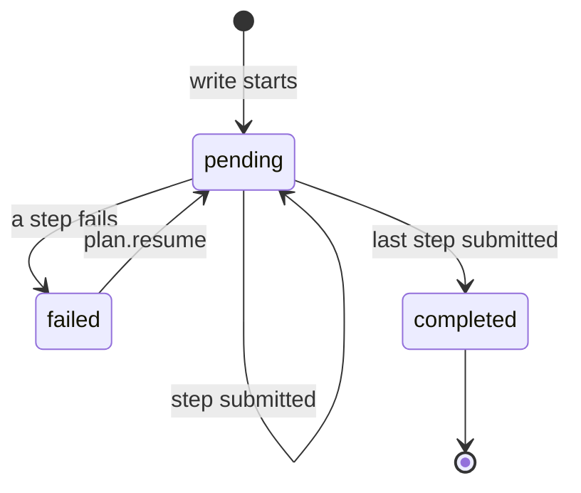

A registration or a [migration](/docs/reference/glossary#migration) is several transactions, grouped in a [plan](/docs/reference/glossary#plan). When one fails, or the page reloads in the
middle, `plan.resume` finishes the rest and skips what already landed.

## Prerequisites

- A client with a wallet. See [Send a transaction](/docs/sdk/send-a-transaction).
- Plan storage that survives your failure. The default is in memory and forgets plans when the
  process or page reloads. See [Save and resume plans](/docs/sdk/save-and-resume-plans).

## How a plan is tracked

Every write saves its progress to the client's storage after each submission. A failed write keeps
the record, so you can continue it.



## 1. Find the plan id

A failure carries the id of its plan in `error.context.planId`, and `error.context.step` names the
step that failed. A write that finished has it on `result.plan.id`.

**Example** (Catching a failed registration)

```ts title="catch.ts"
import type { EIP1193Provider } from "viem";

declare global {
  interface Window {
    ethereum?: EIP1193Provider;
  }
}

import { Duration, Ensforge, Errors, ensActions } from "@ensforge/sdk";
import { createPublicClient, createWalletClient, custom, http } from "viem";
import { sepolia } from "viem/chains";

const publicClient = createPublicClient({ chain: sepolia, transport: http() });
const walletClient = createWalletClient({ chain: sepolia, transport: custom(window.ethereum!) });
const [account] = await walletClient.requestAddresses();
const ens = Ensforge.create({ publicClient, walletClient, account }).extend(ensActions());

let planId: string | undefined;
try {
  await ens.registration.register({ names: "ensforge-docs-demo.eth", duration: Duration.years(1) });
} catch (error) {
  if (Errors.is(error)) planId = error.context.planId;
}
```

An aborted write (`signal`) rejects with `signal.reason`, which has no plan id. Look the plan up
with [`plan.list`](/docs/reference/sdk/plan/list), newest first.

**Example** (Listing plans that did not finish)

```ts title="list.ts"
import { Ensforge, ensActions } from "@ensforge/sdk";
import { createPublicClient, http } from "viem";
import { sepolia } from "viem/chains";

const publicClient = createPublicClient({ chain: sepolia, transport: http() });
const account = "0xA11Ce00000000000000000000000000000000000"; // the account that sent the plans
const ens = Ensforge.create({ publicClient, account }).extend(ensActions());

const failed = await ens.plan.list({ account, status: "failed" });
```

## 2. Look at the progress

[`plan.get`](/docs/reference/sdk/plan/get) returns the saved record, or `null` when no plan
has that id.

```ts title="get.ts"
import { Ensforge, ensActions } from "@ensforge/sdk";
import { createPublicClient, http } from "viem";
import { sepolia } from "viem/chains";

const publicClient = createPublicClient({ chain: sepolia, transport: http() });
const ens = Ensforge.create({ publicClient }).extend(ensActions());
declare const planId: string;

const record = await ens.plan.get({ id: planId });

record?.status; // "pending" | "completed" | "failed"
record?.submitted; // transaction hashes per step id
record?.error; // message of the last failure
```

## 3. Resume the plan

[`plan.resume`](/docs/reference/sdk/plan/resume) continues the plan and resolves once the
remaining transactions are submitted. Use `plan.resumeSync` to wait for the receipts.

**Example** (Resuming and waiting)

```ts title="resume.ts"
import type { EIP1193Provider } from "viem";

declare global {
  interface Window {
    ethereum?: EIP1193Provider;
  }
}

import { Ensforge, ensActions } from "@ensforge/sdk";
import { createPublicClient, createWalletClient, custom, http } from "viem";
import { sepolia } from "viem/chains";

const publicClient = createPublicClient({ chain: sepolia, transport: http() });
const walletClient = createWalletClient({ chain: sepolia, transport: custom(window.ethereum!) });
const [account] = await walletClient.requestAddresses();
const ens = Ensforge.create({ publicClient, walletClient, account }).extend(ensActions());
declare const planId: string;

const { receipts } = await ens.plan.resumeSync({ id: planId });
```

What resuming does:

- A step submitted before is confirmed, not sent again.
- A transaction that was dropped, or a bundle that failed, is sent again.
- Each remaining step is simulated against current state right before it is sent, because the
  earlier steps already changed it.
- A plan for another chain, such as an L2 primary name, resumes on that chain's clients from the
  client's `chains`.

Resume takes the usual write options, such as `onStep`, `mode` and `account`.

## Register again with the same secret

A registration has a second way to continue. The result of `registration.register` carries a
`secret`. Call it again with the same options and that `secret` to finish the registration. The
options are part of the commitment, so they must match exactly.

## Record a transaction sent elsewhere

When you sent a step's transaction outside ensforge, tell the plan with
[`plan.reconcile`](/docs/reference/sdk/plan/reconcile), passing the plan `id`, the `step`
id and the `hash`. Resuming then treats the step as submitted.

## Check the result

After `resumeSync` resolves, `plan.get` reports `status: "completed"`, and `receipts` includes the
steps that were submitted before.

## Troubleshooting

### `PLAN_NOT_FOUND`

The storage has no plan with that id. The default memory storage forgets plans on reload. Pass
`Plan.localStorage()` or your own storage. See [`PLAN_NOT_FOUND`](/docs/reference/errors/PLAN_NOT_FOUND).

### `PLAN_ROUTE_REQUIRED`

Some [steps](/docs/reference/glossary#step) were sent through a [route](/docs/reference/glossary#route) (`via`), such as a smart account. Only that route can follow
them, and sending them again from the wallet would run them twice. Pass the same `via` to
`plan.resume`. See [`PLAN_ROUTE_REQUIRED`](/docs/reference/errors/PLAN_ROUTE_REQUIRED).

### `PLAN_CHAIN_MISMATCH` or `PLAN_ACCOUNT_MISMATCH`

The plan was prepared for another chain or account than the client's. Resume it with the client and
account that started it. See [`PLAN_CHAIN_MISMATCH`](/docs/reference/errors/PLAN_CHAIN_MISMATCH) and
[`PLAN_ACCOUNT_MISMATCH`](/docs/reference/errors/PLAN_ACCOUNT_MISMATCH).

### `COMMITMENT_TOO_OLD`

A resumed registration passed the registrar's [commitment](/docs/reference/glossary#commitment) window. Start the registration again. See
[`COMMITMENT_TOO_OLD`](/docs/reference/errors/COMMITMENT_TOO_OLD).
