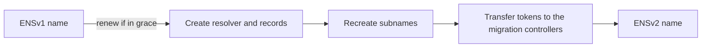

This page is about ENS versions: a name registered on ENSv1 (the original contracts) can **migrate** to ENSv2 (the new registries). Most tasks in these docs work on either version without a choice from you. Migration is the task where the version matters, because it moves a name from one to the other.

You will check a name, migrate it, and confirm it now lives on ENSv2. For the background, see [ENS versions under the hood](/docs/sdk/ens-versions).

## Prerequisites

- A wallet client for the account that holds the name's token (the registrant or the NameWrapper owner), or an approved operator. See [Create a client](/docs/sdk/create-a-client).
- A chain with ENSv2 deployed, such as Sepolia.
- Optional: an indexer, so ensforge can discover the name's records and subnames. See [Connect an indexer](/docs/sdk/connect-an-indexer).

## What migration does

Migration transfers the name's token to the migration controllers, creates the ENSv2 state, and recreates what you want to keep. Your account sends the transactions and no token approvals are needed.



After it, ENSv2 holds the name and its ENSv1 record is held by the Graveyard. Resolver, subregistry and roles follow the route the name took.

## 1. Check the name

[`migration.get`](/docs/sdk/reference/actions/migration/get) reports the route, what blocks it, the resolver plan and what the name becomes.

**Example** (Checking a Name Before Migrating)

```ts twoslash title="migration-get.ts"
// @types: node
import { createPublicClient, createWalletClient, http, type Hex } from "viem";
import { privateKeyToAccount } from "viem/accounts";
import { sepolia } from "viem/chains";
import { Ensforge, ensActions } from "@ensforge/sdk";

const account = privateKeyToAccount(process.env.PRIVATE_KEY as Hex);
const transport = http(process.env.SEPOLIA_RPC_URL);

const ens = Ensforge.create({
  publicClient: createPublicClient({ chain: sepolia, transport }),
  walletClient: createWalletClient({ account, chain: sepolia, transport }),
}).extend(ensActions());

const status = await ens.migration.get({ name: "ensforge-docs-demo.eth" });
//    ^?
```

`status.status` is one of:

| `status`       | Meaning                              |
| -------------- | ------------------------------------ |
| `eligible`     | The name can migrate now.            |
| `blocked`      | See `blockers`.                      |
| `migrated`     | The name is already on ENSv2.        |
| `not-required` | Already on ENSv2, or not registered. |

`status.route` says how the name moves:

| `route`            | Name                                                                                                              |
| ------------------ | ----------------------------------------------------------------------------------------------------------------- |
| `unwrapped`        | A `.eth` second-level name on the ENSv1 registrar.                                                                |
| `wrapped-unlocked` | A wrapped `.eth` name without `cannotUnwrap` burned.                                                              |
| `wrapped-locked`   | A wrapped `.eth` name with `cannotUnwrap` burned. ENSv2 gives it a WrapperRegistry whose roles follow its fuses.  |
| `locked-child`     | A locked or emancipated wrapped subname. It moves into its parent's WrapperRegistry once the parent has migrated. |

`blockers` explain why a name cannot migrate:

| Blocker               | Meaning                                                                        |
| --------------------- | ------------------------------------------------------------------------------ |
| `not-eth`             | Not a `.eth` name or one of its subnames.                                      |
| `expired`             | The ENSv1 registration expired. A name in grace: renew first, or pass `renew`. |
| `not-reserved`        | ENSv2 holds no reservation for the name.                                       |
| `not-owner`           | The account neither holds the token nor is an approved operator.               |
| `cannot-transfer`     | The `cannotTransfer` fuse is burned.                                           |
| `frozen-approval`     | `cannotApprove` is burned while a token approval is set.                       |
| `parent-not-migrated` | A locked child whose parent is still on ENSv1.                                 |
| `unlocked-child`      | A subname without its own token route. It is recreated through its parent.     |
| `locked-resolver`     | `cannotSetResolver` keeps a resolver that could no longer be edited.           |
| `unknown-label`       | Only the label's hash is known.                                                |

`status.resolver.plan` shows what `migrate` does with the current resolver for the same `resolver` option, and `status.after` shows the registry, subregistry, expiry and roles the name gets. With an indexer, `status.discovered` lists the records and subnames that `migrate` carries over by default.

## 2. Migrate

[`migration.migrate`](/docs/sdk/reference/actions/migration/migrate) takes names, each as a string or with the records and subnames to keep. `migration.migrateSync` waits for the receipts and verifies the migrated state.

**Example** (Migrating a Name With Its Profile)

```ts twoslash title="migrate.ts"
// @types: node
import { createPublicClient, createWalletClient, http, type Hex } from "viem";
import { privateKeyToAccount } from "viem/accounts";
import { sepolia } from "viem/chains";
import { Ensforge, ensActions } from "@ensforge/sdk";

const account = privateKeyToAccount(process.env.PRIVATE_KEY as Hex);
const transport = http(process.env.SEPOLIA_RPC_URL);

const ens = Ensforge.create({
  publicClient: createPublicClient({ chain: sepolia, transport }),
  walletClient: createWalletClient({ account, chain: sepolia, transport }),
}).extend(ensActions());

const { plan } = await ens.migration.migrateSync({
  names: {
    name: "ensforge-docs-demo.eth",
    records: { texts: { url: "https://example.com" } },
    subnames: ["pay"],
  },
});
```

- `records` is the name's full profile, written to its new resolver.
- `subnames` lists the subnames to recreate, at any depth, as full names or relative to the name (`"pay"`, `"b.a"`). `[]` recreates none.
- An interrupted migration can run again. Existing resolvers and registries are reused.

| Option                   | Type                                   | Default                                                    | Description                                                                          |
| ------------------------ | -------------------------------------- | ---------------------------------------------------------- | ------------------------------------------------------------------------------------ |
| `names`                  | `string \| NameInput \| NameInput[]`   | required                                                   | Names, or names with `records` and `subnames`.                                       |
| `resolver`               | `"new" \| "owned" \| "keep" \| string` | `"new"` for names on an ENS public resolver, else `"keep"` | What happens to the resolver.                                                        |
| `owner`                  | `string`                               | each token's holder                                        | ENSv2 owner of the names.                                                            |
| `allowIncompleteRecords` | `boolean`                              | `false`                                                    | Copy the common records when a name's records are not given and there is no indexer. |
| `allowLeavingSubnames`   | `boolean`                              | `false`                                                    | Migrate even when a listed subname cannot be recreated.                              |
| `preserveManager`        | `boolean`                              | `false`                                                    | Give each unwrapped name's ENSv1 manager `setResolver` and the record setter roles.  |
| `migrateParents`         | `boolean`                              | `false`                                                    | Migrate the ENSv1 parents of locked subnames first.                                  |
| `renew`                  | `{ duration, paymentToken? }`          | none                                                       | Renew names in their grace period first.                                             |

`resolver` choices:

| Value      | Result                                                                             |
| ---------- | ---------------------------------------------------------------------------------- |
| `"new"`    | A PermissionedResolver created for the name, with its records copied in.           |
| `"owned"`  | The account's shared PermissionedResolver (the ENS app's address), records copied. |
| `"keep"`   | The current resolver. Records on an ENSv1 public resolver become read-only.        |
| An address | A resolver you name.                                                               |

<Callout type="warn" title="Name every record and subname unless you use an indexer">
  ENSv2 drops ENSv1 subnames that are not recreated, and records left on an ENSv1 public resolver
  become read-only. Without an indexer, a name whose resolver holds records fails with
  `RECORDS_UNKNOWN` unless you pass `records` or `allowIncompleteRecords`. Pass every record and
  subname you want to keep. Subname records stay on their ENSv1 resolvers.
</Callout>

## 3. Check the result

Read the name with [`name.get`](/docs/sdk/reference/actions/name/get). A migrated name has `kind: "v2-migrated"` and `migrated: true`. `migrateSync` also verifies the state: a mismatch fails with `VERIFICATION_FAILED`.

## Wrapped and locked names

- A wrapped name that is not locked migrates like an unwrapped one.
- A locked name gets a WrapperRegistry. Its non-emancipated children are registered there after it migrates, which works only when the account sending the migration becomes its owner and `cannotCreateSubdomain` is not burned.
- Emancipated children of a locked name migrate on their own, and the plan carries a warning. Use `migrateParents` to move a locked child's parent first.

See [Wrapped names](/docs/sdk/wrapped-names) and [Lock permissions with fuses](/docs/sdk/fuses).

## Troubleshooting

### `NOT_ELIGIBLE`

A blocker applies. The error lists them, and `migration.get` shows them before you send. See [`NOT_ELIGIBLE`](/docs/sdk/errors/NOT_ELIGIBLE).

### `ALREADY_MIGRATED`

The name is already on ENSv2. See [`ALREADY_MIGRATED`](/docs/sdk/errors/ALREADY_MIGRATED).

### `RECORDS_UNKNOWN`

The name's records are not known, so they cannot be copied. Connect an indexer, pass `records`, or pass `allowIncompleteRecords`. See [`RECORDS_UNKNOWN`](/docs/sdk/errors/RECORDS_UNKNOWN).

### `VERIFICATION_FAILED`

The migration was sent, but the name's ENSv2 state differs from the plan. See [`VERIFICATION_FAILED`](/docs/sdk/errors/VERIFICATION_FAILED).

### `NOT_OWNER` or `FUSE_BURNED`

The account may not move a token. See [`NOT_OWNER`](/docs/sdk/errors/NOT_OWNER) and [`FUSE_BURNED`](/docs/sdk/errors/FUSE_BURNED).

### `UNSUPPORTED_ON_DEPLOYMENT`

The chain has no ENSv2 deployment. See [`UNSUPPORTED_ON_DEPLOYMENT`](/docs/sdk/errors/UNSUPPORTED_ON_DEPLOYMENT).
