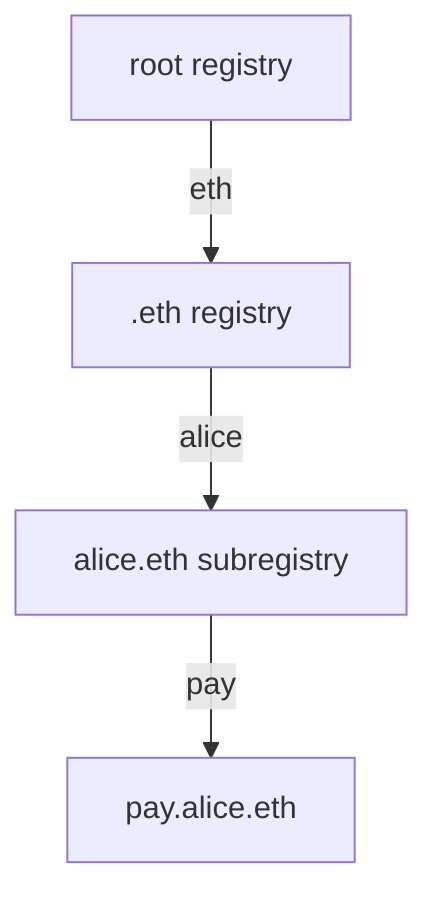

This page is about [ENSv2](/docs/reference/glossary#ensv2) only. [ENSv1](/docs/reference/glossary#ensv1) has one [registry](/docs/reference/glossary#registry) for every name. ENSv2 gives each name that has children its own registry, and calls it the name's **subregistry**. Everything here fails with [`UNSUPPORTED_PROTOCOL`](/docs/reference/errors/UNSUPPORTED_PROTOCOL) or [`UNSUPPORTED_ON_DEPLOYMENT`](/docs/reference/errors/UNSUPPORTED_ON_DEPLOYMENT) for ENSv1 names and chains without ENSv2.

You will inspect the registry that holds a name's children, deploy one, attach it, upgrade it and set its metadata URI. Most apps never need this: [`subname.create`](/docs/sdk/create-subnames) deploys and attaches a registry when a parent has none.

## How registries nest

A registry holds the names directly under it. Each name points to a subregistry for its own children.



| `kind`    | What the registry is                                                                                                    |
| --------- | ----------------------------------------------------------------------------------------------------------------------- |
| `root`    | The root registry.                                                                                                      |
| `eth`     | The `.eth` registry.                                                                                                    |
| `user`    | A UserRegistry that holds a name's children.                                                                            |
| `wrapper` | A WrapperRegistry for a name migrated from the NameWrapper. See [Move a name to ENSv2](/docs/sdk/move-a-name-to-ensv2). |
| `unknown` | Any other contract.                                                                                                     |

An **emancipated** registry is one whose root [role](/docs/reference/glossary#role) holders cannot take children back: they cannot unregister them, repoint them or control their transfers. Children of an emancipated registry keep what they were given.

## Prerequisites

- A wallet client for an account with the roles each write needs. See [Roles and permissions](/docs/sdk/roles-and-permissions).
- An ENSv2 name. See [Register a name](/docs/sdk/register-a-name).

## 1. Inspect a registry

[`registry.get`](/docs/reference/sdk/registry/get) reads a name's subregistry (`{ name }`) or any registry by address (`{ registry }`).

**Example** (Inspecting a Name's Subregistry)

```ts title="registry-get.ts"
import { createPublicClient, http } from "viem";
import { sepolia } from "viem/chains";
import { Ensforge, ensActions } from "@ensforge/sdk";

const ens = Ensforge.create({
  publicClient: createPublicClient({ chain: sepolia, transport: http() }),
}).extend(ensActions());

const registry = await ens.registry.get({ name: "ensforge-docs-demo.eth" });
```

It returns `null` when the name has no subregistry, unless you pass `strict: true`. The result has:

| Field             | Meaning                                                                          |
| ----------------- | -------------------------------------------------------------------------------- |
| `address`, `kind` | The contract and what it is.                                                     |
| `implementation`  | The implementation behind the proxy, or `null` when it is not a proxy.           |
| `parent`          | The registry above it and the label it sits under, as set with `setParent`.      |
| `canonicalName`   | The name whose children it holds, or `null` when not reachable.                  |
| `uri`, `renderer` | Token metadata settings.                                                         |
| `emancipated`     | Whether root role holders can take children back.                                |
| `upgrade`         | `latest` implementation, whether this registry is `eligible`, and the `blocker`. |

Pass `account` to include whether it holds the `upgrade` role.

## 2. Deploy a registry

[`registry.deploy`](/docs/reference/sdk/registry/deploy) deploys a UserRegistry as a verifiable proxy at an address known before sending. With `attachTo` it also becomes that name's subregistry in the same plan.

**Example** (Deploying and Attaching a Subregistry)

```ts title="registry-deploy.ts"
import { createPublicClient, createWalletClient, http, type Hex } from "viem";
import { privateKeyToAccount } from "viem/accounts";
import { sepolia } from "viem/chains";
import { Ensforge, ensActions } from "@ensforge/sdk";

const account = privateKeyToAccount(process.env.PRIVATE_KEY as Hex);
const transport = http(process.env.SEPOLIA_RPC_URL);

const ens = Ensforge.create({
  publicClient: createPublicClient({ chain: sepolia, transport }),
  walletClient: createWalletClient({ account, chain: sepolia, transport }),
}).extend(ensActions());

const { registry } = await ens.registry.deploySync({
  attachTo: "ensforge-docs-demo.eth",
});
```

| Option        | Type                   | Default    | Description                                                  |
| ------------- | ---------------------- | ---------- | ------------------------------------------------------------ |
| `owner`       | `string`               | the signer | Gets every root role.                                        |
| `grants`      | `{ account, roles }[]` | none       | Extra root role grants.                                      |
| `emancipated` | `boolean`              | `false`    | Withhold the roles that would let owners take children back. |
| `attachTo`    | `string`               | none       | ENSv2 name to attach it to.                                  |
| `salt`        | `bigint`               | random     | CREATE2 salt. With the account, it decides the address.      |

## 3. Attach or detach a registry

[`registry.attach`](/docs/reference/sdk/registry/attach) sets a name's subregistry. It calls `setSubregistry` on the registry holding the name, then `setParent` on the new registry so its canonical name points back. Pass `setParent: false` to skip the second call. `registry: null` detaches the current subregistry.

**Example** (Attaching a Registry)

```ts title="registry-attach.ts"
import { createPublicClient, createWalletClient, http, type Hex } from "viem";
import { privateKeyToAccount } from "viem/accounts";
import { sepolia } from "viem/chains";
import { Ensforge, ensActions } from "@ensforge/sdk";

const account = privateKeyToAccount(process.env.PRIVATE_KEY as Hex);
const transport = http(process.env.SEPOLIA_RPC_URL);

const ens = Ensforge.create({
  publicClient: createPublicClient({ chain: sepolia, transport }),
  walletClient: createWalletClient({ account, chain: sepolia, transport }),
}).extend(ensActions());

await ens.registry.attachSync({
  name: "ensforge-docs-demo.eth",
  registry: "0x1111111111111111111111111111111111111111", // a registry you deployed
});
```

## 4. Upgrade a registry

[`registry.upgrade`](/docs/reference/sdk/registry/upgrade) moves a registry to the deployment's latest implementation. It checks before signing what `registry.get` reports: you hold the `upgrade` root role, the target accepts the current implementation, and, for emancipated registries, the upgrade set lists it.

**Example** (Upgrading a Subregistry)

```ts title="registry-upgrade.ts"
import { createPublicClient, createWalletClient, http, type Hex } from "viem";
import { privateKeyToAccount } from "viem/accounts";
import { sepolia } from "viem/chains";
import { Ensforge, ensActions } from "@ensforge/sdk";

const account = privateKeyToAccount(process.env.PRIVATE_KEY as Hex);
const transport = http(process.env.SEPOLIA_RPC_URL);

const ens = Ensforge.create({
  publicClient: createPublicClient({ chain: sepolia, transport }),
  walletClient: createWalletClient({ account, chain: sepolia, transport }),
}).extend(ensActions());

const info = await ens.registry.get({ name: "ensforge-docs-demo.eth", account: account.address });

if (info?.upgrade.eligible) {
  await ens.registry.upgradeSync({ name: "ensforge-docs-demo.eth" });
}
```

When `upgrade.eligible` is `false`, `upgrade.blocker` says why:

| `blocker`         | Meaning                                                                                                                         |
| ----------------- | ------------------------------------------------------------------------------------------------------------------------------- |
| `up-to-date`      | It already runs the latest implementation.                                                                                      |
| `not-approved`    | The latest implementation does not accept the current one, or the registry is emancipated and its upgrade set does not list it. |
| `unauthorized`    | The account lacks the `upgrade` root role.                                                                                      |
| `not-upgradeable` | ensforge knows no upgrade target for this kind of registry.                                                                     |

<Callout type="info" title="Older registries cannot always be upgraded">
  On mainnet, user registries created before the 2026-11-17 redeploy report `not-approved`: the
  current UserRegistry does not accept their implementation, and `registry.upgrade` fails with
  `UPGRADE_NOT_APPROVED`. They keep their token-level `renew` behaviour.
</Callout>

## 5. Set the metadata URI

[`registry.setUri`](/docs/reference/sdk/registry/set-uri) points a registry's token metadata at your own service. It needs the `setUri` root role. It keeps the current URI renderer unless you pass `renderer`, and `renderer: null` removes it.

**Example** (Setting a Metadata URI)

```ts title="registry-set-uri.ts"
import { createPublicClient, createWalletClient, http, type Hex } from "viem";
import { privateKeyToAccount } from "viem/accounts";
import { sepolia } from "viem/chains";
import { Ensforge, ensActions } from "@ensforge/sdk";

const account = privateKeyToAccount(process.env.PRIVATE_KEY as Hex);
const transport = http(process.env.SEPOLIA_RPC_URL);

const ens = Ensforge.create({
  publicClient: createPublicClient({ chain: sepolia, transport }),
  walletClient: createWalletClient({ account, chain: sepolia, transport }),
}).extend(ensActions());

await ens.registry.setUriSync({
  name: "ensforge-docs-demo.eth",
  uri: "https://example.com/names/{id}.json",
});
```

## Troubleshooting

### `UPGRADE_NOT_APPROVED`

The latest implementation does not accept this registry's implementation. Read `registry.get` for the `blocker`. See [`UPGRADE_NOT_APPROVED`](/docs/reference/errors/UPGRADE_NOT_APPROVED).

### `MISSING_ROLES`

The account lacks a root role the write needs: `upgrade`, `setUri` or the roles on the parent. See [Roles and permissions](/docs/sdk/roles-and-permissions) and [`MISSING_ROLES`](/docs/reference/errors/MISSING_ROLES).

### `UNSUPPORTED_PROTOCOL`

The name is an ENSv1 name. Registries exist on ENSv2 only. See [Move a name to ENSv2](/docs/sdk/move-a-name-to-ensv2).
